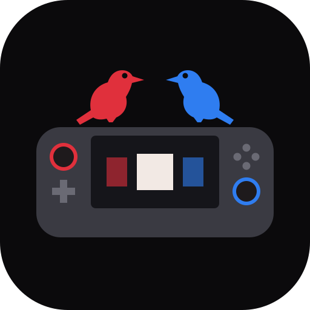
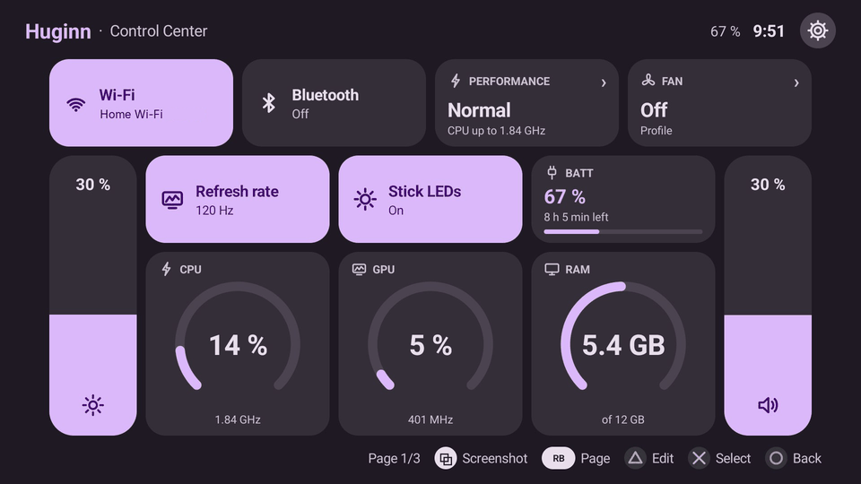
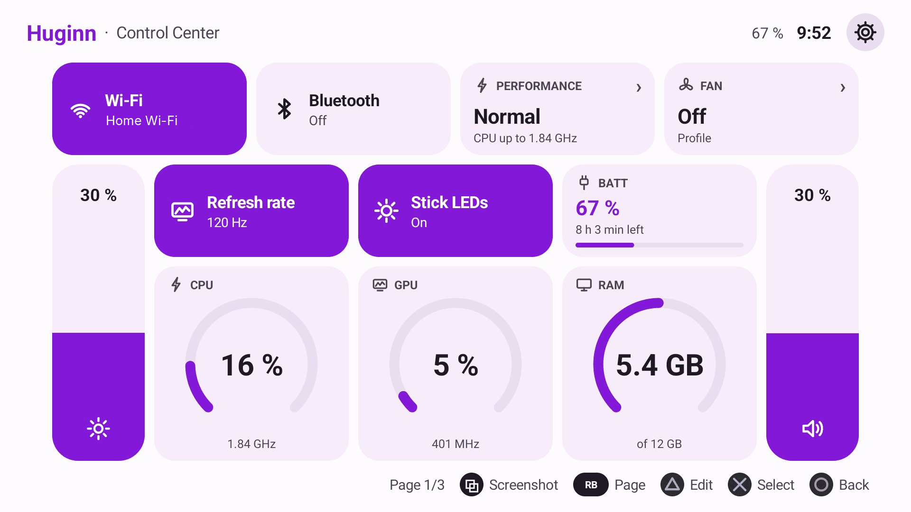
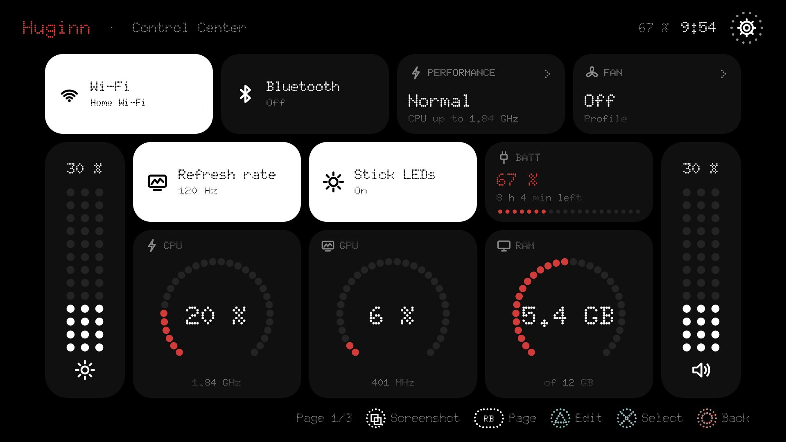
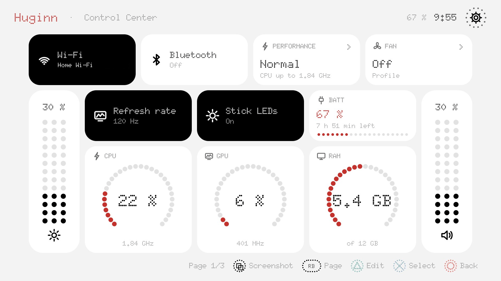
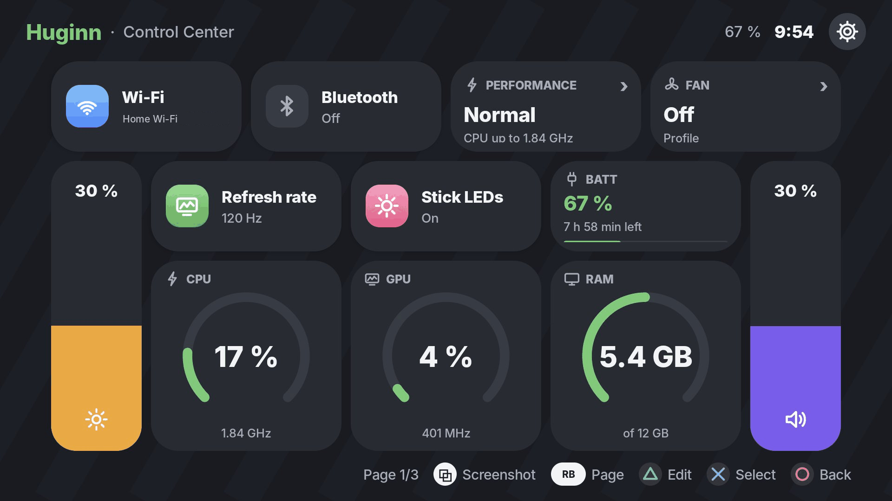

  

<h1 align="center">Hugminn</h1>

  <b>Ein Game Switcher und Control Center für Retroid-Handhelds</b> 
  Android 13 · für den Controller gemacht · Material Design

<a href="README.md">English</a> · <b>Deutsch</b>

---

> **Stand:** getestet auf dem Retroid Pocket 6. Unterstützung für Pocket Nova und Pocket 5 ist geplant.

## Was ist Hugminn?

  

Das Control Center in allen vier Stilen, hell und dunkel

Hugminn ergänzt den Retroid Pocket 6, Pocket Nova und Pocket 5 um zwei Oberflächen wie bei einer Konsole, ohne deinen Launcher zu ersetzen. Du behältst dein Lieblings-Frontend (zum Beispiel Cocoon) für deine Spielesammlung; Hugminn liegt darüber und ist immer nur einen Tastendruck entfernt.

### Warum Hugminn?

Android ist für Touchscreens gemacht. Am Handheld hältst du aber einen Controller in der Hand – und trotzdem musst du zum Spielewechseln oder um Lüfter, Leistungsprofil oder WLAN umzustellen auf den Bildschirm tippen, dich durch Androids Einstellungen wühlen oder ein Schnelleinstellungsmenü bedienen, das nie für ein Steuerkreuz gedacht war.

Das Ziel von Hugminn ist ein **controllerfreundliches Control Center und ein Game Switcher für Android**, so wie Konsolen sie haben: alles mit den Tasten erreichbar, die du sowieso hältst, auf einen Blick lesbar und ohne das Spiel länger als einen Tastendruck zu verlassen. Touch funktioniert weiterhin, du brauchst es aber nie.

### Der Name

In der nordischen Sage fliegen Odins zwei Raben jeden Tag über die Welt und berichten ihm, was sie gesehen haben. Hugminn verbindet ihre Namen, und jeder Rabe ist ein Teil der App:

- **Huginn** („Gedanke“) ist das **Control Center**. Es behält Leistung, Temperatur, Lüfter und LEDs im Blick.
- **Muninn** („Erinnerung“) ist der **Game Switcher**. Er merkt sich, was du zuletzt gespielt hast, und bringt dich direkt dorthin zurück.

## Bilder

| Dunkel | Hell |
| --- | --- |
|  |  |
| Modern | Modern |
|  |  |
| Pixel | Pixel |
|  |  |
| Punktmatrix | Punktmatrix |
|  |  |
| Cocoon | Cocoon |

Jede Ansicht in jedem Stil: **[Stile und Farbschemata](https://github.com/Ninte86hl/Hugminn/wiki/Stile-und-Farbschemata)** im Wiki.

## Funktionen

Jede Funktion hat eine eigene Seite im **[Wiki](https://github.com/Ninte86hl/Hugminn/wiki/Startseite)**.

| | |
| --- | --- |
| **[Game Switcher](https://github.com/Ninte86hl/Hugminn/wiki/Game-Switcher-DE)** | Home zweimal: deine letzten Spiele als große Karten mit Vorschaubild und dem Titel des laufenden Spiels, z. B. „Crash Bandicoot 2“ über DuckStation. Blättern mit dem Steuerkreuz, Apps mit einer Taste schließen. |
| **[Control Center](https://github.com/Ninte86hl/Hugminn/wiki/Control-Center-DE)** | Home lang: WLAN, Bluetooth, Helligkeit, Lautstärke, Musik, Akku-Restzeit, Controller-Akku, Bildschirm aus und Live-Werte für CPU, GPU, RAM und Temperatur in einem Raster aus Kacheln. |
| **[Bearbeiten](https://github.com/Ninte86hl/Hugminn/wiki/Control-Center-bearbeiten)** | Kacheln auf mehreren Seiten anordnen, vergrößern und hinzufügen; Kachelfarbe wählen. |
| **[Leistung und Lüfter](https://github.com/Ninte86hl/Hugminn/wiki/Leistung-und-Luefter)** | Leistungs- und Lüfterprofile, eigene Lüfterkurve und Profile, die sich Hugminn pro Emulator oder pro Spiel merkt. |
| **[Stick-LEDs](https://github.com/Ninte86hl/Hugminn/wiki/Stick-LEDs-DE)** | Farbrad, Schnellfarben und Effekte; oder die Sticks zeigen Akku oder Temperatur als Farbe. |
| **[Leistungs-Overlay](https://github.com/Ninte86hl/Hugminn/wiki/Leistungs-Overlay)** | FPS, Frametime, CPU, GPU, Temperatur und mehr über dem Spiel, im gewählten Stil. |
| **[Home-Taste](https://github.com/Ninte86hl/Hugminn/wiki/Home-Taste)** | Drücken, zweimal drücken und halten, jeweils mit eigener Aktion. |
| **[Stile und Farbschemata](https://github.com/Ninte86hl/Hugminn/wiki/Stile-und-Farbschemata)** | Modern, Pixel, Punktmatrix und Cocoon; hell, dunkel oder OLED-Schwarz; deine eigene Akzentfarbe. |
| **[Einstellungen](https://github.com/Ninte86hl/Hugminn/wiki/Einstellungen)** | Alles einstellbar, Sichern und Wiederherstellen, Deutsch und Englisch. |

Pausieren: Auf Wunsch hält das Spiel (Bild und Ton) an, solange der Switcher oder das Control Center offen ist. Alles geht mit dem Controller; Touch funktioniert auch.

## Unterstützte Geräte

| Gerät | Chip | Bildschirm | Stand |
| --- | --- | --- | --- |
| Retroid Pocket 6 | Snapdragon 8 Gen 2 (QCS8550) | 5,5" 16:9, 1080p, 120 Hz | Hauptgerät |
| Retroid Pocket Nova | QCS8550 | 4,5" 4:3, 1280×960, 120 Hz | geplant |
| Retroid Pocket 5 | Snapdragon 865 | 5,5" 16:9, 1080p, 60 Hz | geplant |

Hugminn erkennt das Gerät und zeigt nur, was es kann – zum Beispiel keinen 120-Hz-Schalter auf dem Pocket 5. Auf dem Pocket Nova nutzt das Control Center ein 4:3-Layout.

## Voraussetzungen

- Eines der Geräte oben mit Original-Firmware
- Die meisten Systemfunktionen laufen über den eingebauten privilegierten Dienst der Firmware (`PServerBinder`); ein eigenes Root ist nicht nötig. Ohne ihn öffnet Hugminn stattdessen die passenden Systemeinstellungen.
- Hugminn läuft als Bedienungshilfe (für die Home-Taste, die Overlays und Screenshots). Technische Details: [So funktioniert es](https://github.com/Ninte86hl/Hugminn/wiki/So-funktioniert-es).

## Installation

Jede Version erscheint unter **Releases**, automatisch gebaut und signiert von GitHub Actions.

- **Direkter Download:** [hugminn.apk](https://github.com/Ninte86hl/Hugminn/releases/latest/download/hugminn.apk) (immer die neueste Version)
- **Mit [Obtainium](https://github.com/ImranR98/Obtainium) (empfohlen, hält Hugminn aktuell):** [obtainium.json](https://raw.githubusercontent.com/Ninte86hl/Hugminn/main/obtainium.json) herunterladen (hängt auch an jeder Version) und in Obtainium unter *Import/Export → Obtainium Import* importieren.
  Es geht auch von Hand: einfach `https://github.com/Ninte86hl/Hugminn` als Quelle hinzufügen.

Nach der Installation Hugminn öffnen: eine kurze [Einführung](https://github.com/Ninte86hl/Hugminn/wiki/Einrichtungsassistent) erklärt Game Switcher und Control Center, schaltet die Bedienungshilfe ein und lässt dich abschalten, was du nicht brauchst.

**Testversionen** aus dem `test`-Zweig (mit zusätzlichen Diagnosewerkzeugen) erscheinen als Vorabversionen namens *Hugminn Test*. Sie sind mit demselben Schlüssel signiert, du kannst also ohne Neuinstallation zwischen Test- und normaler Version wechseln.

## Fehler melden

Einstellungen → **Fehler melden** öffnet ein vorausgefülltes [Issue](https://github.com/Ninte86hl/Hugminn/issues) auf GitHub. Mehr dazu im [Wiki](https://github.com/Ninte86hl/Hugminn/wiki/Fehler-melden).

## Berechtigungen

Hugminn hat **keine Internet-Berechtigung** und sendet nie etwas irgendwohin. Es braucht die Bedienungshilfe und ein paar Berechtigungen für WLAN, Bluetooth und den Switcher; wofür jede einzelne ist, steht im Wiki: **[Berechtigungen](https://github.com/Ninte86hl/Hugminn/wiki/Berechtigungen)**.

## Danksagungen

Diese Projekte haben gezeigt, was auf AYN- und Retroid-Handhelds möglich ist, und Teile von Hugminn inspiriert:

- [Thor Wayfinder](https://github.com/Thor-Wayfinder/thor-wayfinder): Controller-Steuerung für die Übersicht der letzten Apps
- [Better Dual Screen Assistant](https://github.com/stormpanda/better-dual-screen-assistant): Systemeinstellungen und der privilegierte Dienst der Firmware
- [Bifrost](https://github.com/Pollux-MoonBench/Bifrost): Steuerung der Stick-LEDs und ihre Schnittstelle
- [P.U.L.S.E.](https://github.com/keiretrogaming/pulse): Leistungsoptimierung auf dem Retroid Pocket 6; die Idee, FPS über SurfaceFlinger TimeStats zu messen
- [ClusterTune](https://github.com/AurelioB/ClusterTune): CPU- und GPU-Frequenzgrenzen

Hugminn ist ein unabhängiges Projekt und gehört weder zu Retroid, AYN noch zu einem der Projekte oben.

## Schriften von Dritten

- [Inter](https://github.com/rsms/inter) von The Inter Project Authors, SIL Open Font License 1.1 (siehe `app/src/main/assets/fonts/Inter-OFL.txt`)
- [NF Pixels](https://github.com/sgigou/NF-Pixels) Pixelschrift von Steve Gigou, SIL Open Font License 1.1 (siehe `app/src/main/assets/fonts/NFPixels-OFL.txt`)
- [Doto](https://github.com/oliverlalan/Doto) Punktmatrix-Schrift von Óliver Lalan, SIL Open Font License 1.1 (siehe `app/src/main/assets/fonts/Doto-OFL.txt`)

## Autor

Erstellt von [Ninte86hl](https://github.com/Ninte86hl).

## Lizenz

Hugminn ist freie Software unter der [GNU General Public License v3.0](LICENSE). Du darfst es nutzen, untersuchen, weitergeben und verändern; veränderte Versionen, die du weitergibst, müssen unter derselben Lizenz stehen. Die enthaltenen Schriften behalten ihre eigene SIL Open Font License.
