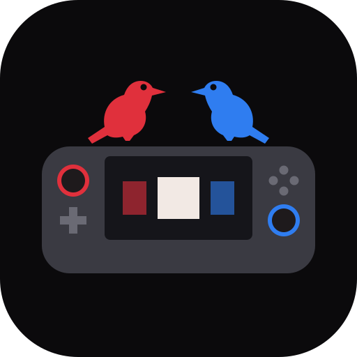
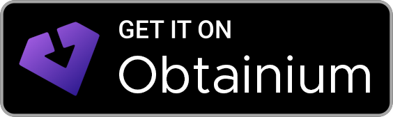
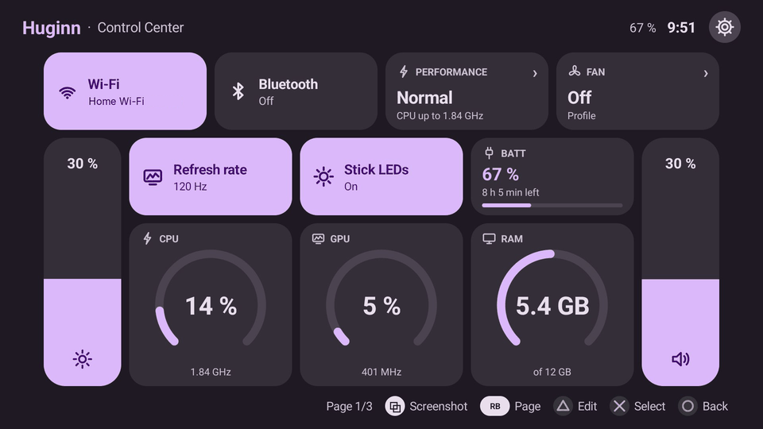
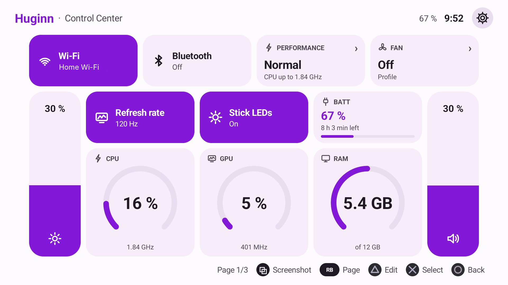
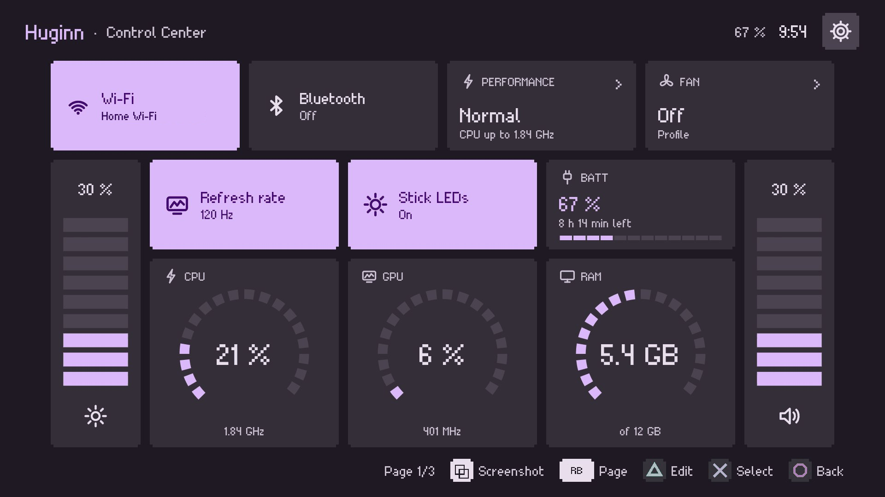
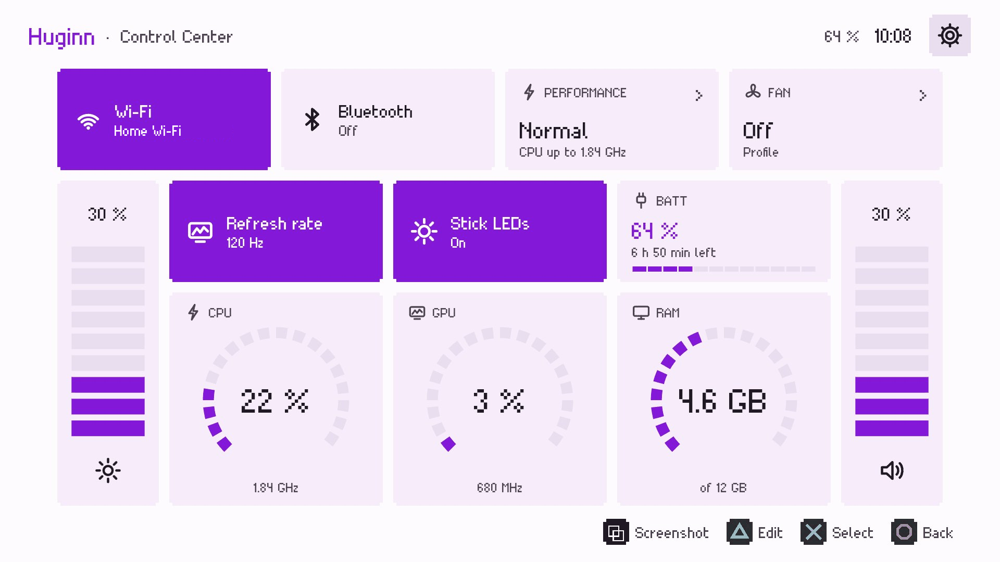
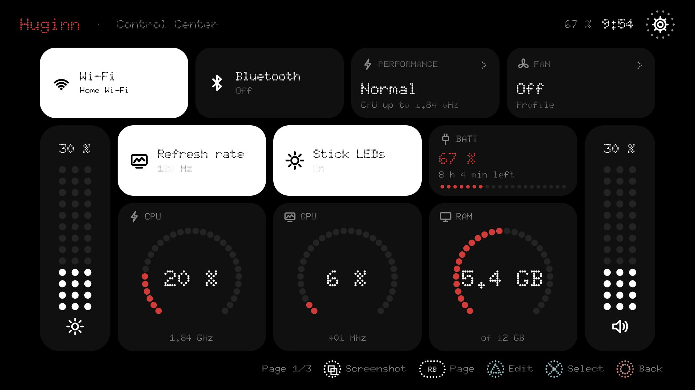
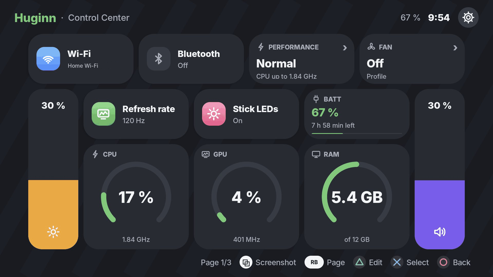
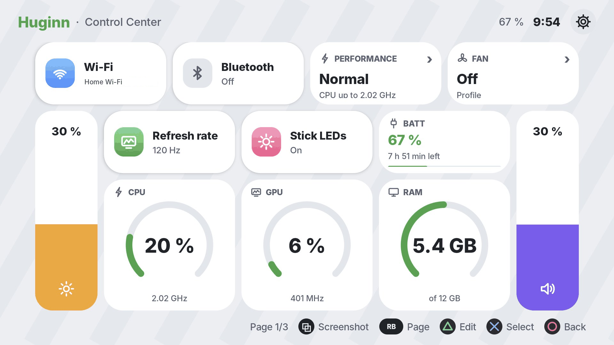

  

<h1 align="center">Hugminn</h1>

  <b>A game switcher and control center for Retroid handhelds</b> 
  Android 13 · controller-first · Material Design

  <a href="https://apps.obtainium.imranr.dev/redirect?r=obtainium://app/%7B%22id%22%3A%22io.github.ninte86hl.hugminn%22%2C%22url%22%3A%22https%3A%2F%2Fgithub.com%2FNinte86hl%2FHugminn%22%2C%22author%22%3A%22Ninte86hl%22%2C%22name%22%3A%22Hugminn%22%2C%22additionalSettings%22%3A%22%7B%5C%22includePrereleases%5C%22%3A%20false%2C%20%5C%22fallbackToOlderReleases%5C%22%3A%20true%2C%20%5C%22filterReleaseTitlesByRegEx%5C%22%3A%20%5C%22%5EHugminn%20v%5C%5C%5C%5Cd%5C%22%2C%20%5C%22filterReleaseNotesByRegEx%5C%22%3A%20%5C%22%5C%22%2C%20%5C%22verifyLatestTag%5C%22%3A%20false%2C%20%5C%22sortMethodChoice%5C%22%3A%20%5C%22date%5C%22%2C%20%5C%22useLatestAssetDateAsReleaseDate%5C%22%3A%20false%2C%20%5C%22releaseTitleAsVersion%5C%22%3A%20false%2C%20%5C%22trackOnly%5C%22%3A%20false%2C%20%5C%22versionExtractionRegEx%5C%22%3A%20%5C%22%5C%22%2C%20%5C%22matchGroupToUse%5C%22%3A%20%5C%22%5C%22%2C%20%5C%22versionDetection%5C%22%3A%20true%2C%20%5C%22releaseDateAsVersion%5C%22%3A%20false%2C%20%5C%22useVersionCodeAsOSVersion%5C%22%3A%20false%2C%20%5C%22apkFilterRegEx%5C%22%3A%20%5C%22%5Ehugminn%5C%5C%5C%5C.apk%24%5C%22%2C%20%5C%22invertAPKFilter%5C%22%3A%20false%2C%20%5C%22autoApkFilterByArch%5C%22%3A%20true%2C%20%5C%22appName%5C%22%3A%20%5C%22Hugminn%5C%22%2C%20%5C%22appAuthor%5C%22%3A%20%5C%22Ninte86hl%5C%22%2C%20%5C%22shizukuPretendToBeGooglePlay%5C%22%3A%20false%2C%20%5C%22allowInsecure%5C%22%3A%20false%2C%20%5C%22exemptFromBackgroundUpdates%5C%22%3A%20false%2C%20%5C%22skipUpdateNotifications%5C%22%3A%20false%2C%20%5C%22about%5C%22%3A%20%5C%22Game%20Switcher%20%28Muninn%29%20and%20Control%20Center%20%28Huginn%29%20for%20Retroid%20and%20AYN%20handhelds.%5C%22%2C%20%5C%22refreshBeforeDownload%5C%22%3A%20false%7D%22%2C%22overrideSource%22%3A%22GitHub%22%7D"></a>

<b>English</b> · <a href="README.de.md">Deutsch</a>

---

> **Status:** tested on the Retroid Pocket 6. Pocket Nova and Pocket 5 support is planned.

## What is Hugminn?

  

The Control Center in all four styles, light and dark

Hugminn adds two console-style overlays to the Retroid Pocket 6, Pocket Nova and Pocket 5 without replacing your launcher. You keep your favourite frontend (such as Cocoon) for your library; Hugminn sits on top and is always one button press away.

### Why Hugminn?

Android was made for touch screens. On a handheld you hold a controller, yet switching between games or changing the fan, the performance profile or the Wi-Fi still means reaching for the screen, digging through Android's settings or waiting for a quick settings panel that was never designed for a D-pad.

The goal of Hugminn is a **controller-friendly control center and game switcher for Android**, the way consoles have one: everything reachable with the buttons you are already holding, readable at a glance, and without leaving your game for longer than a button press. Touch still works, but you never need it.

### The name

In Norse mythology, Odin's two ravens fly over the world every day and report back what they have seen. Hugminn joins their names, and each raven is one part of the app:

- **Huginn** ("thought") is the **Control Center**. It keeps an eye on performance, temperature, fan and LEDs.
- **Muninn** ("memory") is the **Game Switcher**. It remembers what you played last and takes you straight back to it.

## Screenshots

| Dark | Light |
| --- | --- |
|  |  |
| Modern | Modern |
|  |  |
| Pixel | Pixel |
|  |  |
| Dot matrix | Dot matrix |
|  |  |
| Cocoon | Cocoon |

Every screen in every style: **[Styles and themes](https://github.com/Ninte86hl/Hugminn/wiki/Styles-and-Themes)** in the wiki.

## Features

Each feature has its own page in the **[wiki](https://github.com/Ninte86hl/Hugminn/wiki)**.

| | |
| --- | --- |
| **[Game Switcher](https://github.com/Ninte86hl/Hugminn/wiki/Game-Switcher)** | Home twice: your recent games as large cards with live previews and the running game's title, e.g. "Crash Bandicoot 2" above DuckStation. Browse with the D-pad, close apps with one button. |
| **[Control Center](https://github.com/Ninte86hl/Hugminn/wiki/Control-Center)** | Hold Home: Wi-Fi, Bluetooth, brightness, volume, music, battery time, controller battery, screen off and live CPU/GPU/RAM/temperature values in a grid of tiles. |
| **[Editing](https://github.com/Ninte86hl/Hugminn/wiki/Editing-the-Control-Center)** | Arrange, resize and add tiles on several pages; pick the tile colour. |
| **[Performance and fan](https://github.com/Ninte86hl/Hugminn/wiki/Performance-and-Fan)** | Performance and fan profiles, a custom fan curve, and profiles remembered per emulator or per game. |
| **[Stick LEDs](https://github.com/Ninte86hl/Hugminn/wiki/Stick-LEDs)** | Colour wheel, quick colours and effects; or the sticks show battery or temperature as a colour. |
| **[Performance overlay](https://github.com/Ninte86hl/Hugminn/wiki/Performance-Overlay)** | FPS, frame time, CPU, GPU, temperature and more over the game, in the style you chose. |
| **[Home button](https://github.com/Ninte86hl/Hugminn/wiki/Home-Button)** | Press, double press and hold, each with its own action. |
| **[Styles and themes](https://github.com/Ninte86hl/Hugminn/wiki/Styles-and-Themes)** | Modern, Pixel, Dot matrix and Cocoon; light, dark or OLED black; your own accent colour. |
| **[Settings](https://github.com/Ninte86hl/Hugminn/wiki/Settings)** | Everything adjustable, backup and restore, English and German. |

Pausing: the game can pause (picture and sound) while the switcher or the Control Center is open. Everything works with the controller; touch works too.

## Supported devices

| Device | Chip | Display | Status |
| --- | --- | --- | --- |
| Retroid Pocket 6 | Snapdragon 8 Gen 2 (QCS8550) | 5.5" 16:9, 1080p, 120 Hz | primary target |
| Retroid Pocket Nova | QCS8550 | 4.5" 4:3, 1280×960, 120 Hz | planned |
| Retroid Pocket 5 | Snapdragon 865 | 5.5" 16:9, 1080p, 60 Hz | planned |

Hugminn detects the device and only shows what it supports, for example no 120 Hz toggle on the Pocket 5. On the Pocket Nova, the Control Center uses a 4:3 layout.

## Requirements

- One of the devices above on stock firmware
- Most system features use the firmware's built-in privileged service (`PServerBinder`), so no separate root setup is needed. Without it, Hugminn opens the matching system settings instead.
- Hugminn runs as an accessibility service (for the Home button, the overlays and screenshots). Technical details: [How it works](https://github.com/Ninte86hl/Hugminn/wiki/How-It-Works).

## Installation

Every release is published under **Releases**, built and signed automatically by GitHub Actions.

- **Direct download:** [hugminn.apk](https://github.com/Ninte86hl/Hugminn/releases/latest/download/hugminn.apk) (always the newest release)
- **With [Obtainium](https://github.com/ImranR98/Obtainium) (recommended, keeps Hugminn up to date):** on the handheld, tap [Add to Obtainium](https://apps.obtainium.imranr.dev/redirect?r=obtainium://app/%7B%22id%22%3A%22io.github.ninte86hl.hugminn%22%2C%22url%22%3A%22https%3A%2F%2Fgithub.com%2FNinte86hl%2FHugminn%22%2C%22author%22%3A%22Ninte86hl%22%2C%22name%22%3A%22Hugminn%22%2C%22additionalSettings%22%3A%22%7B%5C%22includePrereleases%5C%22%3A%20false%2C%20%5C%22fallbackToOlderReleases%5C%22%3A%20true%2C%20%5C%22filterReleaseTitlesByRegEx%5C%22%3A%20%5C%22%5EHugminn%20v%5C%5C%5C%5Cd%5C%22%2C%20%5C%22filterReleaseNotesByRegEx%5C%22%3A%20%5C%22%5C%22%2C%20%5C%22verifyLatestTag%5C%22%3A%20false%2C%20%5C%22sortMethodChoice%5C%22%3A%20%5C%22date%5C%22%2C%20%5C%22useLatestAssetDateAsReleaseDate%5C%22%3A%20false%2C%20%5C%22releaseTitleAsVersion%5C%22%3A%20false%2C%20%5C%22trackOnly%5C%22%3A%20false%2C%20%5C%22versionExtractionRegEx%5C%22%3A%20%5C%22%5C%22%2C%20%5C%22matchGroupToUse%5C%22%3A%20%5C%22%5C%22%2C%20%5C%22versionDetection%5C%22%3A%20true%2C%20%5C%22releaseDateAsVersion%5C%22%3A%20false%2C%20%5C%22useVersionCodeAsOSVersion%5C%22%3A%20false%2C%20%5C%22apkFilterRegEx%5C%22%3A%20%5C%22%5Ehugminn%5C%5C%5C%5C.apk%24%5C%22%2C%20%5C%22invertAPKFilter%5C%22%3A%20false%2C%20%5C%22autoApkFilterByArch%5C%22%3A%20true%2C%20%5C%22appName%5C%22%3A%20%5C%22Hugminn%5C%22%2C%20%5C%22appAuthor%5C%22%3A%20%5C%22Ninte86hl%5C%22%2C%20%5C%22shizukuPretendToBeGooglePlay%5C%22%3A%20false%2C%20%5C%22allowInsecure%5C%22%3A%20false%2C%20%5C%22exemptFromBackgroundUpdates%5C%22%3A%20false%2C%20%5C%22skipUpdateNotifications%5C%22%3A%20false%2C%20%5C%22about%5C%22%3A%20%5C%22Game%20Switcher%20%28Muninn%29%20and%20Control%20Center%20%28Huginn%29%20for%20Retroid%20and%20AYN%20handhelds.%5C%22%2C%20%5C%22refreshBeforeDownload%5C%22%3A%20false%7D%22%2C%22overrideSource%22%3A%22GitHub%22%7D) – Obtainium opens with Hugminn ready to add. Or download [obtainium.json](https://raw.githubusercontent.com/Ninte86hl/Hugminn/main/obtainium.json) and import it in Obtainium under *Import/Export → Obtainium Import*.
  Manual setup works too: just add `https://github.com/Ninte86hl/Hugminn` as source.

After installing, open Hugminn: a short [introduction](https://github.com/Ninte86hl/Hugminn/wiki/Setup-Wizard) explains the Game Switcher and the Control Center, turns on the accessibility service and lets you switch off what you don't need.

**Test builds** from the `test` branch (with extra diagnostic tools) are published as pre-releases named *Hugminn Test*; for Obtainium use [obtainium-test.json](https://raw.githubusercontent.com/Ninte86hl/Hugminn/main/obtainium-test.json) (also attached to every test build). They are signed with the same key, so you can switch between test and release builds without reinstalling.

## Reporting bugs

Settings → **Report a bug** opens a prefilled GitHub [issue](https://github.com/Ninte86hl/Hugminn/issues). More in the [wiki](https://github.com/Ninte86hl/Hugminn/wiki/Reporting-Bugs).

## Permissions

Hugminn has **no internet permission** and never sends anything anywhere. It needs the accessibility service and a few permissions for Wi-Fi, Bluetooth and the switcher; what each one is for is explained in the wiki: **[Permissions](https://github.com/Ninte86hl/Hugminn/wiki/Permissions)**.

## Acknowledgements

These projects showed what is possible on AYN and Retroid handhelds and inspired parts of Hugminn:

- [Thor Wayfinder](https://github.com/Thor-Wayfinder/thor-wayfinder): controller navigation for the recent-apps view
- [Better Dual Screen Assistant](https://github.com/stormpanda/better-dual-screen-assistant): system settings and the firmware's privileged service
- [Bifrost](https://github.com/Pollux-MoonBench/Bifrost): stick LED control and its integration API
- [P.U.L.S.E.](https://github.com/keiretrogaming/pulse): performance tuning on the Retroid Pocket 6; the idea of measuring FPS through SurfaceFlinger TimeStats
- [ClusterTune](https://github.com/AurelioB/ClusterTune): CPU and GPU frequency limits

Hugminn is an independent project and is not affiliated with Retroid, AYN or any of the projects above.

## Third-party assets

- [Inter](https://github.com/rsms/inter) font by The Inter Project Authors, SIL Open Font License 1.1 (see `app/src/main/assets/fonts/Inter-OFL.txt`)
- [NF Pixels](https://github.com/sgigou/NF-Pixels) pixel font by Steve Gigou, SIL Open Font License 1.1 (see `app/src/main/assets/fonts/NFPixels-OFL.txt`)
- [Doto](https://github.com/oliverlalan/Doto) dot-matrix font by Óliver Lalan, SIL Open Font License 1.1 (see `app/src/main/assets/fonts/Doto-OFL.txt`)
- "Get it on Obtainium" badge from the [Obtainium](https://github.com/ImranR98/Obtainium) project, offered there for linking apps to Obtainium

## Author

Created by [Ninte86hl](https://github.com/Ninte86hl).

## License

Hugminn is free software, licensed under the [GNU General Public License v3.0](LICENSE). You may use, study, share and change it; changed versions you share must be under the same license. The bundled fonts keep their own SIL Open Font License.
