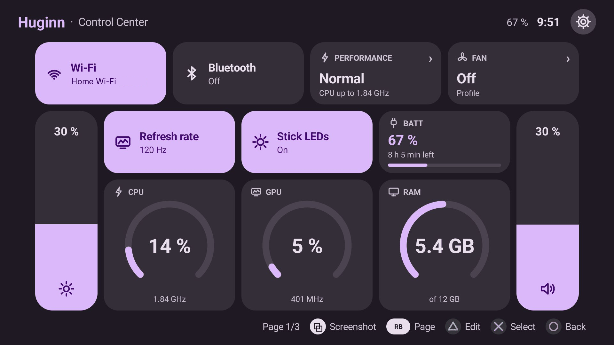

# Control Center (Huginn)

Halte **Home** gedrückt, um das Control Center zu öffnen: ein Raster aus Kacheln über den ganzen Bildschirm mit allem, was du beim Spielen umstellst.

## Bedienung
- Das Steuerkreuz bewegt sich durch das Raster; ausgewählt ist erst etwas, wenn du eine Richtung drückst.
- **A** schaltet einen Schalter oder bestätigt einen Regler, **□ / X** öffnet das Untermenü der Kachel, **△ / Y** das Bearbeiten-Menü, **R1/L1** wechselt die Seite, **○ / B** schließt.
- **Select** macht einen Screenshot.
- Die **Lautstärketasten** des Geräts funktionieren wie gewohnt; ein Lautstärke-Regler auf dem Bildschirm bewegt sich mit.
- **Start** spielt/pausiert die Musik, **L2 / R2** springen zum vorherigen / nächsten Titel.

## Kacheln
- **Schalter:** WLAN, Bluetooth, Stick-LEDs, 60/120 Hz, Nicht stören, Flugmodus, Drehung sperren, Bildschirm an und mehr.
- **Regler:** Lautstärke und Helligkeit in 5-%-Schritten, senkrecht oder waagerecht. Erst A drücken, dann ändert das Steuerkreuz den Wert – so verstellst du beim Bewegen nichts aus Versehen.
- **Karten:** Leistungs- und Lüfterprofil, CPU, GPU, RAM, Temperaturen, Akku und FPS. Die Anzeigen färben sich nach Auslastung.
- **Akku:** zeigt die Restzeit, beim Laden die Zeit bis voll.
- **Musik:** was gerade läuft, Play/Pause, nächster und vorheriger Titel für jede Musik-App. Als große Kachel (2×2, 4×2 oder 4×4) mit Cover, Interpret, Fortschritt und Tasten.
  - Funktioniert mit jedem Player: über seine Mediensitzung oder, bei Playern die sonst nichts melden (z. B. Androids eigene Musik-App), über seine Benachrichtigung.
  - Titel werden aufgeräumt: Zusätze wie „(Official Video)“ fallen weg, „Interpret - Titel“ wird getrennt, Dateinamen verlieren Nummer und Endung („02 Lied.mp3“ → „Lied“).
  - Ein zu langer Titel läuft von rechts nach links durch.
- **Bildschirm aus:** schickt den Handheld in den Ruhemodus wie die Power-Taste; das Spiel pausiert, bis du ihn aufweckst.
- **Geräte-Akku:** Akkustand verbundener Bluetooth-Controller und -Kopfhörer, sofern sie ihn melden.
- **Android-Einstellungen:** öffnet Androids Einstellungen.

## Größen
Jedes Element gibt es in den Größen, die zu ihm passen (im [Bearbeitungsmodus](Control-Center-bearbeiten): A → Größe). Elemente in einer Größe, die es nicht mehr gibt, nehmen die nächstpassende.

| Element | Größen | Was die großen Größen zeigen |
| --- | --- | --- |
| Schalter (WLAN, Bluetooth, LEDs …) | 1×1, 2×1 | 1×1 das Symbol, 2×1 mit Name und Zustand |
| WLAN | 1×1, 2×1, 2×2, 4×2 | Aktuelles Netz und die stärksten in Reichweite; antippen verbindet |
| Bluetooth | 1×1, 2×1, 2×2, 4×2 | Gekoppelte Geräte mit Akkustand; antippen verbindet oder trennt |
| Musik | 1×1, 2×1, 2×2, 4×2, 4×4 | Titel, Interpret, Cover, Fortschritt und Tasten ⏮ ⏯ ⏭; lange Titel laufen durch |
| System-Übersicht | 4×2, 4×4 | FPS, CPU, GPU, RAM, Akku und Leistungsaufnahme als Ringe; 4×4 zusätzlich Frametime- und Temperatur-Graph |
| Leistung / Lüfter | 2×1, 2×2, 3×2 | Das aktuelle Profil groß, mit aktuellem CPU-Takt bzw. Lüfter-Drehzahl und Balken |
| FPS | 2×1, 2×2, 4×2 | Bildrate mit Frametime-Graph |
| CPU / GPU / RAM / Temperatur / Watt | 1×1, 2×1, 2×2 | 1×1 der Wert, 2×1 mit Details und Balken, 2×2 als Ring |
| Akku | 1×1, 2×1, 2×2 | Ring mit Ladung, Restzeit, Leistungsaufnahme und Temperatur |
| Helligkeit / Lautstärke | senkrecht 1×2–1×4, waagerecht 2×1–4×1 | |

Jedes Element darf mehrfach vorkommen (z. B. eine kleine und eine große Musik-Kachel). Elemente sitzen genau dort, wo du sie im Bearbeitungsmodus hingelegt hast.

Auf großen Kacheln macht A dasselbe wie auf der kleinen (schalten, Play/Pause, Menü öffnen), □ / X öffnet das Untermenü.

## Untermenüs
- **WLAN:** Netze in Reichweite mit Signalstärke; gespeicherte Netze verbinden sich direkt, für neue öffnet sich ein Passwortfenster, das du mit dem Controller ausfüllen kannst.
- **Bluetooth:** gekoppelte Geräte (verbinden / trennen) mit dem Akkustand verbundener Geräte, neue Geräte suchen und koppeln. Hugminn bestätigt den Kopplungsdialog für dich.
- **Leistung und Lüfter:** siehe [Leistung und Lüfter](Leistung-und-Luefter).
- **Stick-LEDs:** siehe [Stick-LEDs](Stick-LEDs-DE).

## Spiel pausieren
Auf Wunsch hält das Spiel (Bild und Ton) an, solange das Control Center offen ist (Einstellungen → Control Center → *Spiel pausieren*).

Welche Kacheln wo erscheinen, steht unter [Control Center bearbeiten](Control-Center-bearbeiten).
