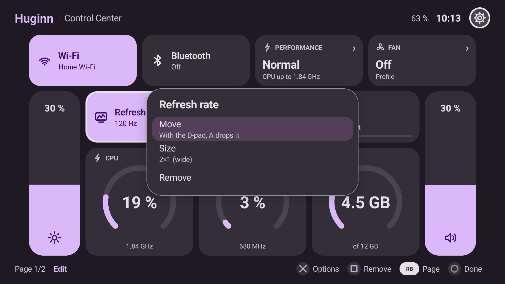
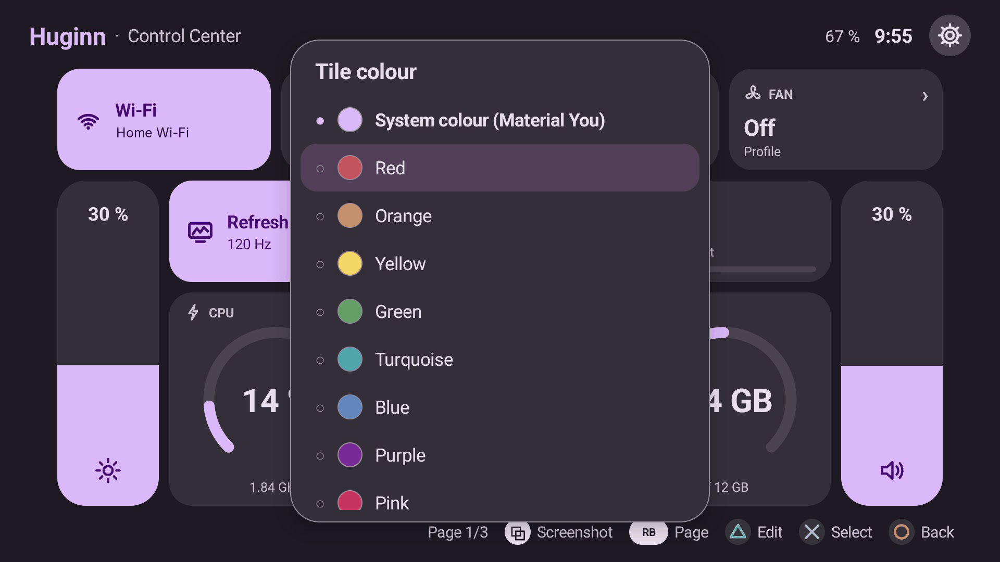

# Control Center bearbeiten

Drück im Control Center **△ / Y**, um das Bearbeiten-Menü zu öffnen. Es erscheint als **Seitenleiste** rechts, so siehst du jede Änderung direkt daneben im Control Center. **L1 / R1** wechseln zwischen vier Kategorien; **hoch/runter** wählt eine Zeile, **◀ ▶** ändert ihren Wert (sofort sichtbar), **A** führt Aktionen aus.

| Kategorie | Einträge |
| --- | --- |
| **Layout** | Anordnen & Größe (Bearbeitungsmodus: verschieben, vergrößern, entfernen) · Element hinzufügen (Schalter, Anzeigen, Regler) · Zeilen (3–6) · Spalten (automatisch oder 4–10) · Standard wiederherstellen |
| **Stil** | Stil (Modern, Pixel, Punktmatrix, Cocoon, Liquid Glass) · Farbschema (System, hell, dunkel, OLED-Schwarz) · Kachelfarbe (◀ ▶ Vorgaben, **A** öffnet das Farbrad) · Farben der Anzeigen |
| **Hintergrund** | Bild (Stil-Farbe, Android-Hintergrundbild mit Root, eigenes Bild – **A** wählt bzw. lädt neu) · Abdunkeln/Aufhellen · Weichzeichnen · Kacheln (Standard, OLED-Schwarz, Glas) · Glas-Stärke · Auswahl-Markierung (automatisch, Ecken, Rahmen) |
| **Overlay** | [Leistungs-Overlay](Leistungs-Overlay) an/aus · Werte · Position · Anordnung · Größe |

Zeilen, die gerade nicht passen, bleiben ausgeblendet: Abdunkeln und Weichzeichnen nur mit Bild, Glas-Stärke nur mit Glas-Kacheln. Alles davon gibt es auch in den [Einstellungen](Einstellungen) der App unter *Darstellung* → *Hintergrund & Kacheln*.

## Bearbeitungsmodus

- Element auswählen und **A** drücken: ein Menü bietet *Verschieben* (mit dem Steuerkreuz, A legt ab), *Größe* (z. B. 2×1 breit) und *Entfernen*.
- Touch geht auch: Element lange drücken und ziehen.
- Freie Felder haben einen gestrichelten Rand; A auf einem freien Feld öffnet die Auswahl für ein neues Element.
- Das Raster hat mehrere Seiten (R1/L1). Wie viele Zeilen und Spalten es hat, stellst du in den [Einstellungen](Einstellungen) ein.

## Kachelfarbe

Wähle *Systemfarbe (Material You)*, eine der Vorgaben oder eine beliebige Farbe aus dem Farbrad.
