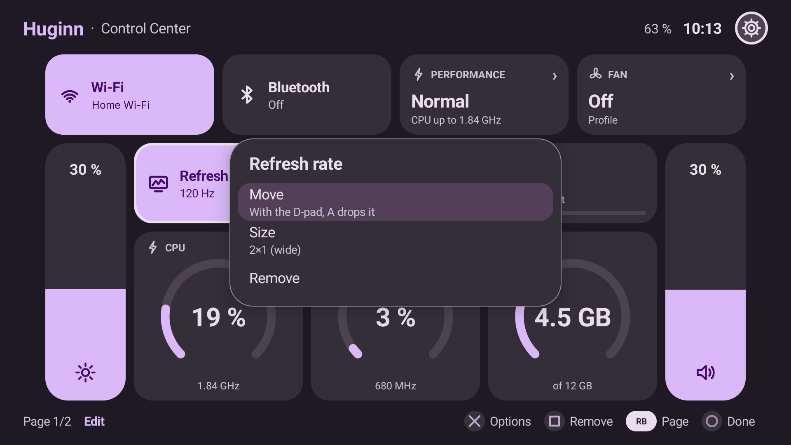
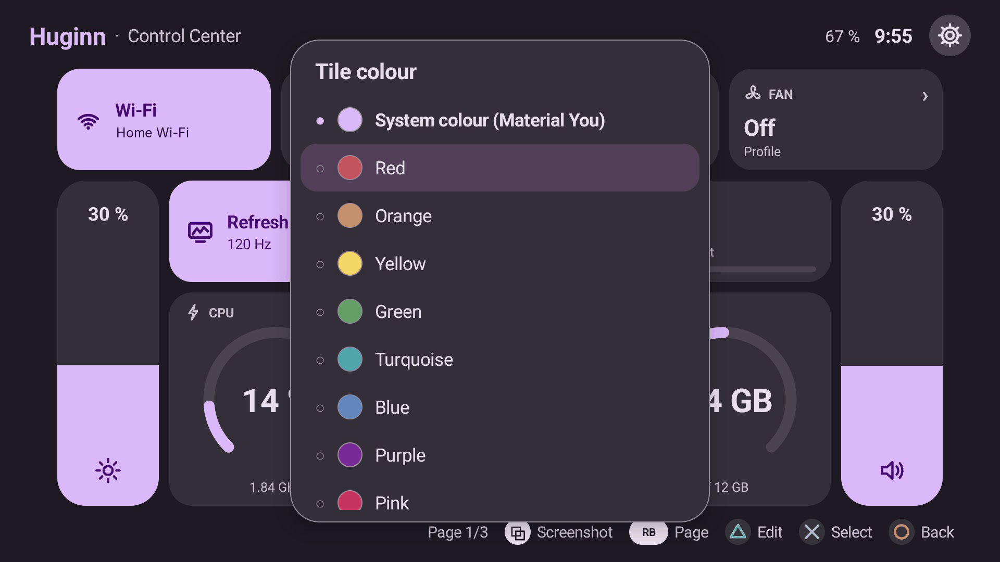

# Editing the Control Center

Press **△ / Y** in the Control Center to open the edit menu. It opens as a **side panel** on the right, so every change can be watched on the Control Center next to it. **L1 / R1** switch between four categories; **up/down** picks a line, **◀ ▶** changes its value (live), **A** runs actions.

| Category | Entries |
| --- | --- |
| **Layout** | Arrange & size (edit mode: move, resize, remove) · Add element (switches, displays, sliders) · Rows (3–6) · Columns (automatic or 4–10) · Restore defaults |
| **Style** | Style (Modern, Pixel, Dot matrix, Cocoon, Liquid Glass) · Colour scheme (system, light, dark, OLED black) · Tile colour (◀ ▶ presets, **A** opens the colour wheel) · Gauge colours |
| **Background** | Picture (style colour, Android wallpaper with root, own picture – **A** chooses or reloads) · Darken/Lighten · Blur · Tiles (standard, OLED black, glass) · Glass strength · Selection mark (automatic, corners, frame) |
| **Overlay** | [Performance overlay](Performance-Overlay) on/off · Values · Position · Arrangement · Size |

Lines that don't apply stay hidden: darken and blur only appear with a picture, glass strength only with glass tiles. Everything here also exists in the app's [settings](Settings) under *Look* → *Background & tiles*.

## Edit mode

- Select an element and press **A**: a menu offers *Move* (with the D-pad, A drops it), *Size* (e.g. 2×1 wide) and *Remove*.
- Touch works too: long-press an element and drag it.
- Free cells show a dashed outline; pressing A on one opens the picker for a new element.
- The grid has several pages (R1/L1). The number of rows and columns can be set in the [settings](Settings).

## Tile colour

Choose *System colour (Material You)*, one of the presets or any colour from the colour wheel.
