# Einrichtungsassistent

Beim ersten Öffnen führt dich eine kurze Einführung durch alles. Sie ist für den Controller gemacht: **Zurück**, **Überspringen** und **Weiter** stehen auf jeder Seite an derselben Stelle. Du kannst sie jederzeit wieder öffnen: Einstellungen → **Hilfe & Info** → *Einführung erneut zeigen*.

Neu in 1.12: Hugminn erteilt sich nichts mehr still. Du entscheidest über jede Berechtigung, öffnest Game Switcher und Control Center einmal selbst, und ein kurzer Tastentest prüft, dass Hugminn alle Tasten sieht. Am Ende kannst du eine kurze Zusammenfassung schicken – nur wenn du willst.

## 1. Willkommen
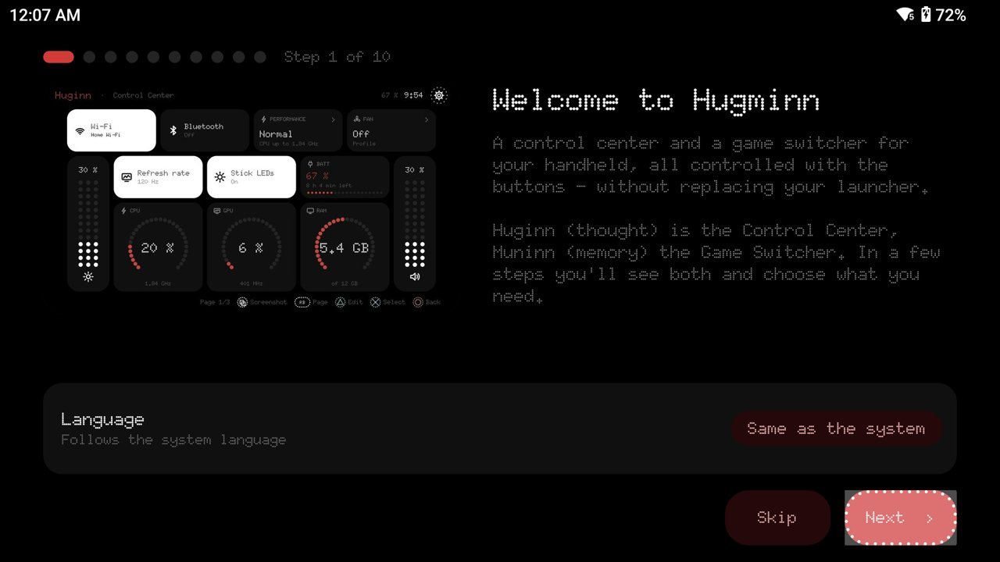

Was Hugminn ist. Hier lässt sich die Sprache wählen (standardmäßig wie das System).

## 2. Hugminn einschalten
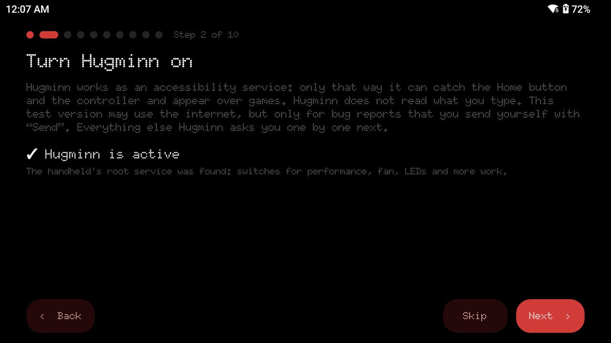

Hugminn arbeitet als Bedienungshilfe – nur so kann es die Home-Taste abfangen und sich über Spiele legen. Dieser Schritt schaltet nur das ein; alles Weitere wird auf der nächsten Seite einzeln gefragt. Die Seite zeigt auch, ob der Root-Dienst des Handhelds gefunden wurde (nötig für Leistung, Lüfter und LEDs).

## 3. Was Hugminn darf
| Vorher | Nachher |
| --- | --- |
| 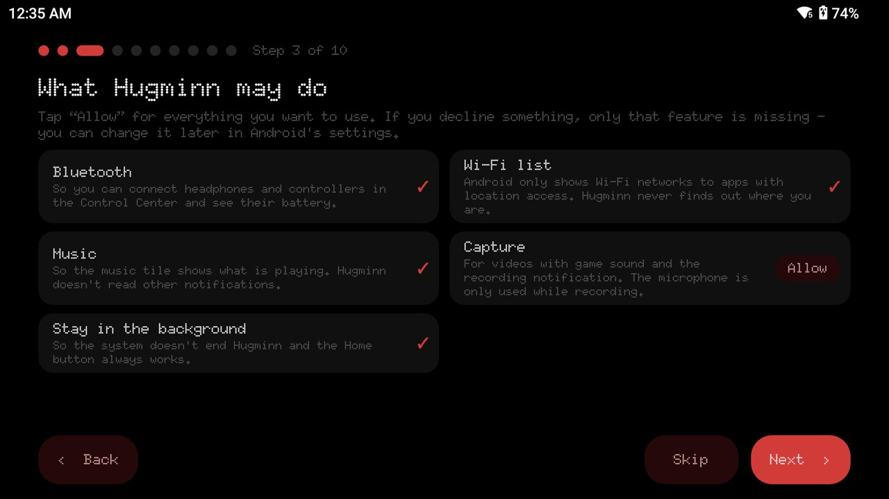 | 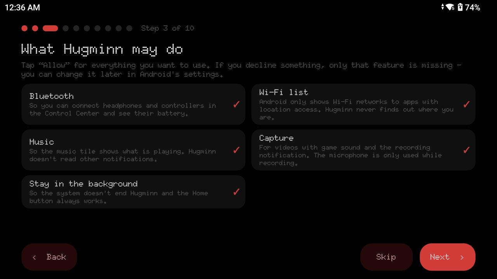 |

Jede Berechtigung hat eine Karte mit einem Satz, wofür sie da ist. **Erlauben** öffnet Androids eigenen Dialog oder – wo Android keinen hat – lässt Hugminn es über den Root-Dienst einschalten. Lehnst du etwas ab, fehlt nur diese Funktion.

| Karte | Wofür |
| --- | --- |
| Bluetooth | Kopfhörer und Controller im Control Center verbinden und ihren Akku sehen. |
| WLAN-Liste | Android zeigt WLAN-Netze nur Apps mit Standortzugriff. Hugminn bestimmt nie, wo du bist. |
| Musik | Damit die Musik-Kachel zeigt, was läuft. Andere Mitteilungen werden nicht gelesen. |
| Aufnahme | Videos mit Spielton und die Aufnahme-Mitteilung. Das Mikrofon wird nur bei einer Aufnahme benutzt. |
| Im Hintergrund bleiben | Damit das System Hugminn nicht beendet und die Home-Taste immer funktioniert. Ohne Root öffnet eine kurze Anleitung Androids Dialog „im Hintergrund erlauben“. |
| Helligkeit & Systemwerte *(nur ohne Root)* | Helligkeit, Bildschirm-Aus-Zeit und ähnliche Regler. |
| Zuletzt genutzte Apps *(nur ohne Root)* | So erfährt der Switcher, welche Spiele zuletzt offen waren. |

## 4. Probier es aus
| | |
| --- | --- |
| 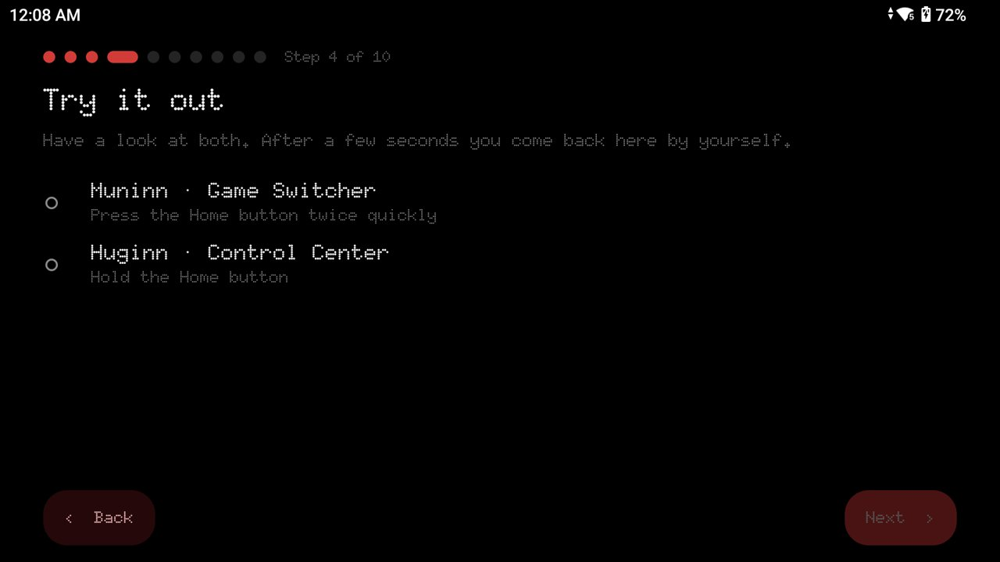 | 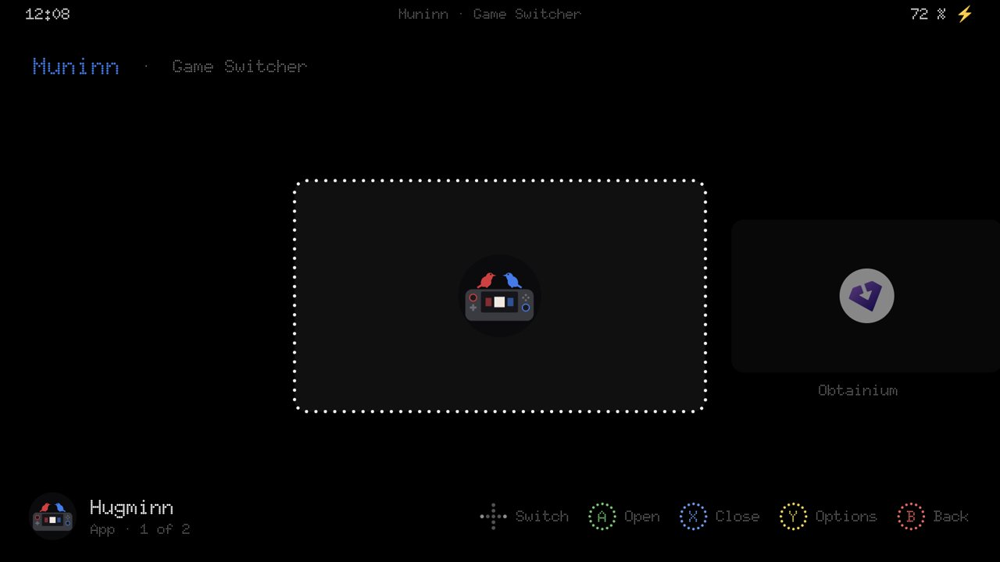 |
| 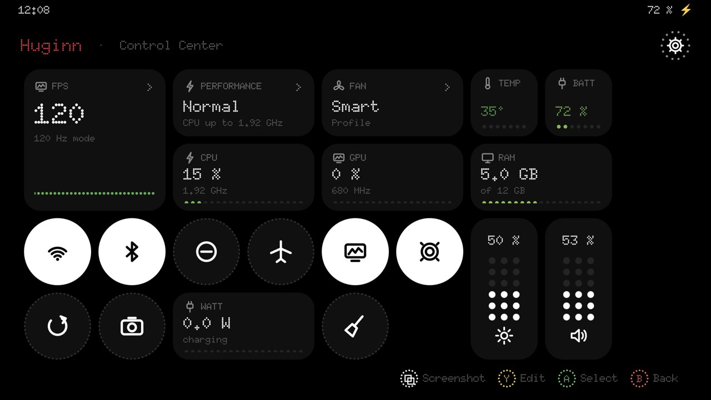 | |

Öffne den Game Switcher (Home zweimal) und das Control Center (Home halten) einmal selbst. Beide schließen sich nach 5 Sekunden, und du bist zurück im Assistenten. Klappt eine Geste nicht, erscheint nach 30 Sekunden *Klappt nicht – weiter* (das steht dann in der Zusammenfassung).

## 5. Tastentest
| | |
| --- | --- |
| 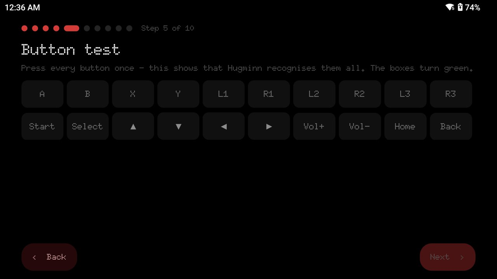 | 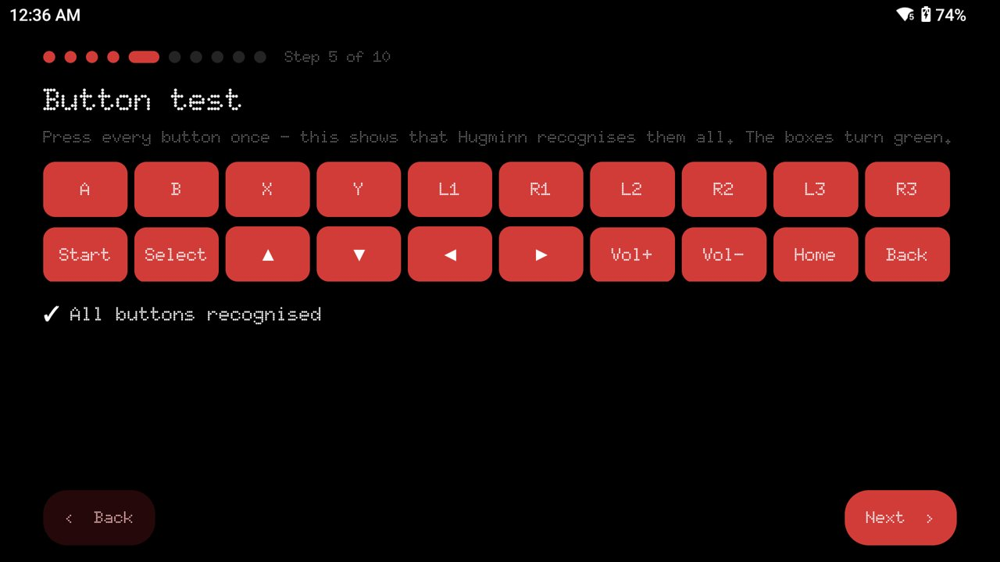 |

Jede Taste einmal drücken: A, B, X, Y, Schultertasten, Trigger, Stick-Klicks, Start, Select, Steuerkreuz, Lautstärke, Home und Zurück. Die Felder werden grün; sind alle gedrückt, geht es von selbst weiter.

## 6. Game Switcher · 7. Control Center
| | |
| --- | --- |
| 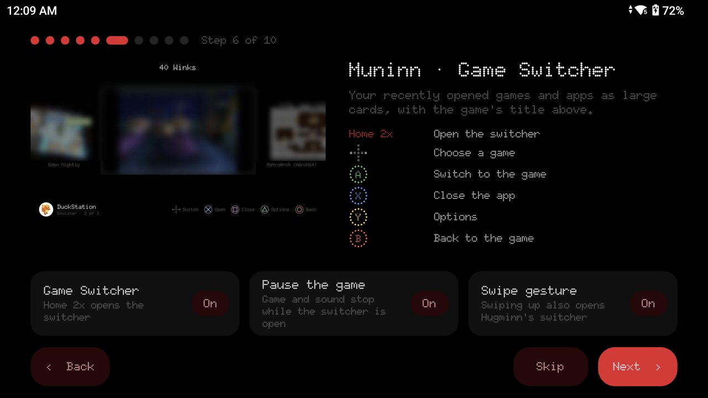 | 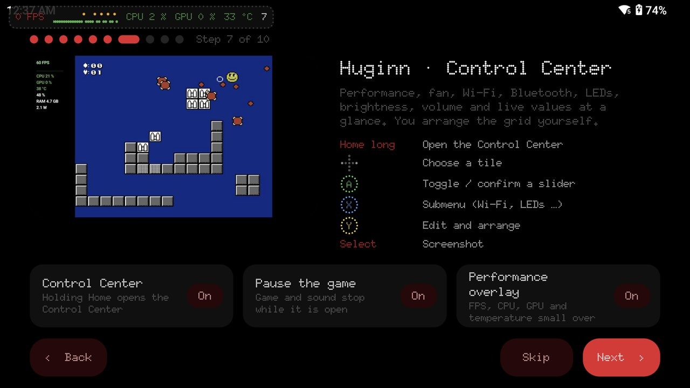 |

Jeweils an oder aus, Spiel pausieren, solange es offen ist, die Wischgeste für den Switcher und das [Leistungs-Overlay](Leistungs-Overlay).

## 8. Aussehen · 9. Tastensymbole
| | |
| --- | --- |
| 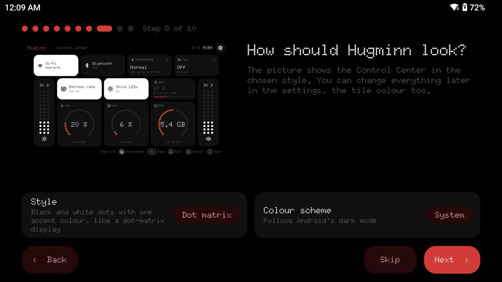 | 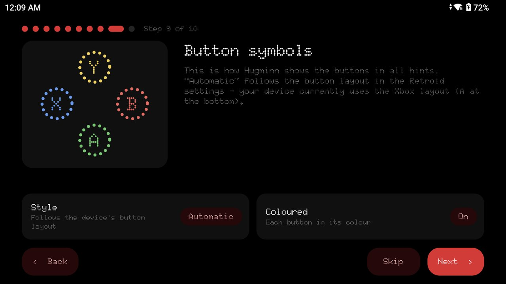 |

[Stil](Stile-und-Farbschemata) und Farbschema, danach Xbox-, Nintendo- oder PlayStation-Symbole (oder *Automatisch* nach dem Retroid-Tastenlayout), farbig oder schlicht.

## 10. Fertig – und ein freiwilliger Bericht
| | |
| --- | --- |
| 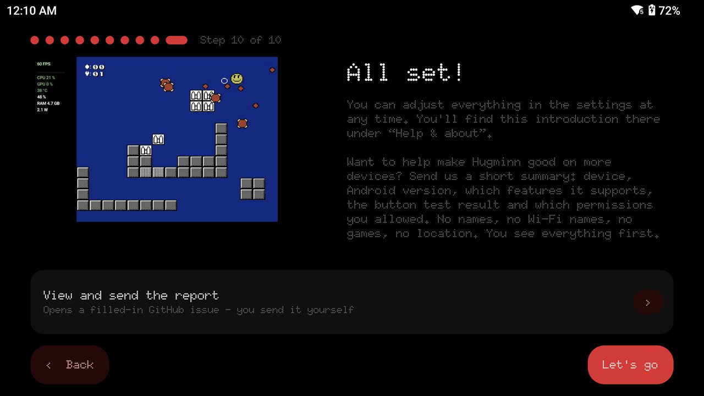 | 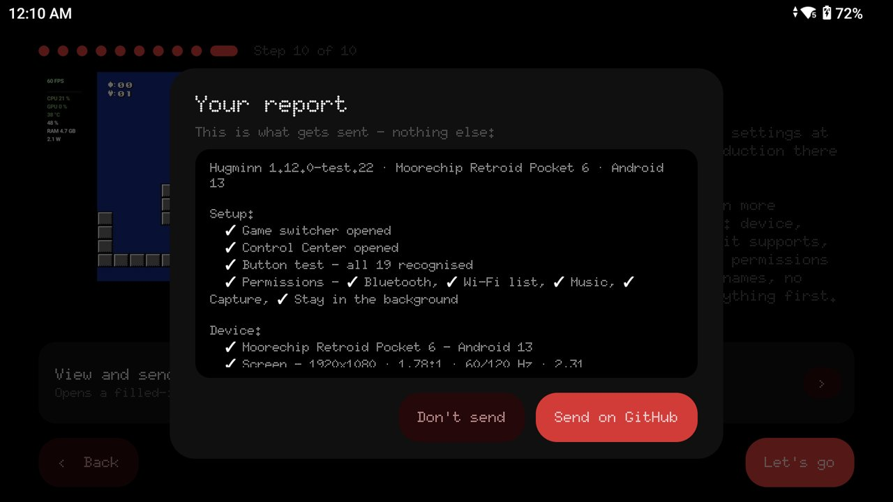 |

*Bericht ansehen und senden* zeigt genau, was gesendet würde: Gerät, Android-Version, welche Funktionen das Gerät unterstützt, ob Switcher und Control Center aufgingen, der Tastentest und welche Berechtigungen du erlaubt hast. **Keine Namen, keine WLAN-Namen, keine Spiele, kein Standort.** *Auf GitHub senden* öffnet einen ausgefüllten [Gerätebericht](https://github.com/Ninte86hl/Hugminn/issues/new?template=device-report.yml) im Browser – du schickst ihn selbst ab. Hugminn selbst hat keine Internet-Berechtigung.

Jede Wahl lässt sich später in den [Einstellungen](Einstellungen) ändern.
