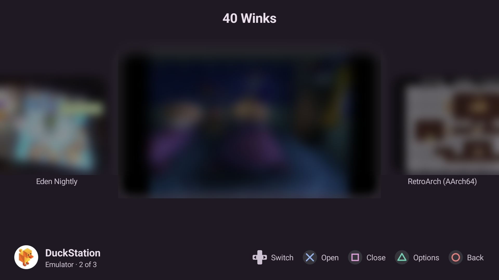

# Game Switcher (Muninn)

Muninn zeigt deine zuletzt benutzten Spiele und Apps als große Karten, die gewählte in der Mitte mit ihrem Vorschaubild. Du öffnest ihn mit **Home zweimal**.

Oben steht wie im Control Center die Kopfzeile **Muninn · Game Switcher** mit Uhrzeit und Akku.

## Was er zeigt
- **Vorschaubilder**, die Hugminn selbst aufnimmt, wenn du Home drückst, und alle paar Sekunden beim Spielen – die Karten zeigen also, wo du aufgehört hast.
- **Den Spieltitel** über der Karte, wenn ein Emulator läuft, z. B. „Crash Bandicoot 2“ über DuckStation. Hugminn findet ihn über die geöffnete Spieldatei, das Protokoll des Emulators, RetroArchs Verlauf oder den Launcher, der ihn gestartet hat (siehe [So funktioniert es](So-funktioniert-es#spieltitel)).
- Nur echte Apps: dein Launcher (Cocoon, ES-DE …) und Hugminn selbst stehen nie in der Liste. Anderswo geschlossene Apps verschwinden.

## Bedienung

| Taste | Aktion |
| --- | --- |
| Steuerkreuz, linker Stick, L1/R1 | Blättern |
| A | App öffnen (ihre laufende Aufgabe kommt wieder nach vorn) |
| □ / X | App schließen, auch aus Androids Übersicht |
| △ / Y | Optionen: [Tastenkürzel](Tastenkuerzel) (Emulatoren), anheften / lösen, App-Info, alle anderen schließen |
| ○ / B | Zurück, wo du warst |
| Select | Screenshot samt Switcher, gespeichert unter Bilder/Screenshots |

Touch geht auch: seitlich wischen zum Blättern, Karte nach oben wischen zum Schließen, antippen zum Öffnen.

## Optionen
- **Spiel pausieren:** Solange der Switcher offen ist, wird das Spiel verdeckt und hält an, auch der Ton. Es läuft weiter, wenn du zurückgehst.
- **Wischgeste:** Wischen vom unteren Rand kann statt Androids Übersicht Hugminns Switcher öffnen.
- **Klassischer Modus:** Statt des eigenen Switchers legt Hugminn einen Rahmen über Androids Übersicht (Einstellungen → Game Switcher → *Eigene Übersicht* aus).
