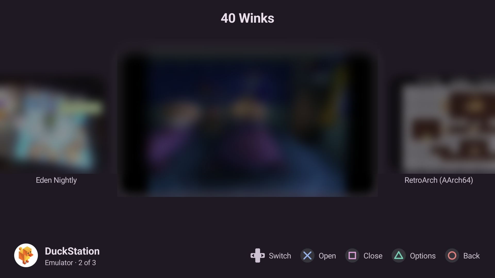

# Game Switcher (Muninn)

Muninn shows your recently used games and apps as large cards, the selected one in the middle with its preview picture. Open it by pressing **Home twice**.

At the top, like in the Control Center, the header shows **Muninn · Game Switcher** with clock and battery.

## What it shows
- **Preview pictures** taken by Hugminn itself when you press Home and every few seconds while you play, so the cards show where you left off.
- **The game title** above the card when an emulator is running, e.g. "Crash Bandicoot 2" above DuckStation. Hugminn finds it from the open game file, the emulator's log, RetroArch's history or the launcher that started it (see [How it works](How-It-Works#game-titles)).
- Only real apps: your home app (Cocoon, ES-DE …) and Hugminn itself are never listed. Apps closed elsewhere disappear.

## Controls

| Button | Action |
| --- | --- |
| D-pad, left stick, L1/R1 | Browse |
| A | Open the app (its running task comes back to the front) |
| West (X · Retro Y · □) | Close the app, also removing it from Android's recent apps |
| North (Y · Retro X · △) | Options: [shortcuts](Emulator-Shortcuts) (emulators), pin / unpin, app info, close all others |
| ○ / B | Back to where you were |

Touch works too: swipe sideways to browse, swipe a card up to close it, tap to open.

## Options
- **Pause the game:** while the switcher is open, the game is covered and pauses, including its sound. It continues when you go back.
- **Swipe gesture:** swiping up from the bottom of the screen can open Hugminn's switcher instead of Android's recent apps.
- **Classic mode:** instead of its own switcher, Hugminn can lay a frame over Android's own recent-apps view (Settings → Game Switcher → *Own overview* off).

## Video apps
- **Keep playing:** while music or a video plays (Spotify, YouTube & co.), opening the switcher or the Control Center no longer pauses it – games still pause.
- **Always landscape:** YouTube, Netflix, Disney+, Prime Video and Crunchyroll are shown fully in landscape, not only full-screen videos (Settings → Game Switcher → *Video apps always landscape*).

## Tip: turn off picture-in-picture
Recommended for everyone who uses Hugminn: switch off **picture-in-picture** for your video apps (YouTube, Netflix, Disney+, Prime Video …). Otherwise a video shrinks into a small floating window when you switch to another app, that lies over your game and the switcher – and you have to close or move that little player by hand every time. YouTube does it too.

Android settings → **Apps** → **Special app access** → **Picture-in-picture** → switch it off for each video app (the exact names can differ slightly between devices).
