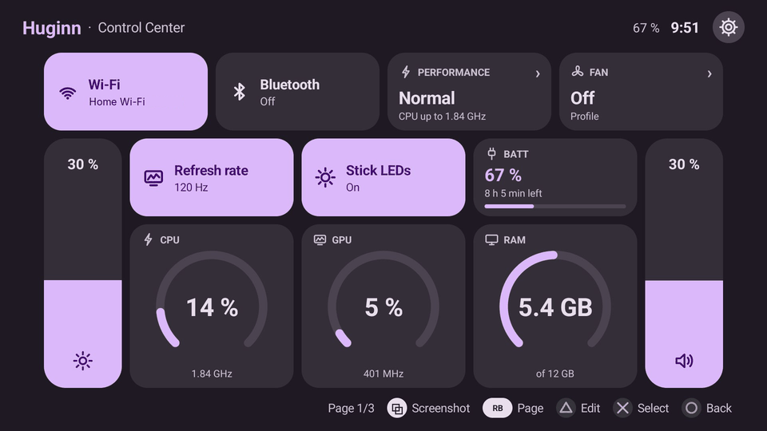

# Hugminn Wiki

*[Deutsche Version](Startseite)*

Hugminn adds a **Game Switcher** (Muninn) and a **Control Center** (Huginn) to Retroid handhelds, both fully usable with the controller. Your launcher stays as it is.

## Getting started
- [Setup wizard](Setup-Wizard) – what the introduction asks and why
- [Home button](Home-Button) – how to open the switcher and the Control Center

## Features
- [Game Switcher](Game-Switcher) – switch between games and apps with the D-pad
- [Control Center](Control-Center) – tiles, sliders, live values, Wi-Fi and Bluetooth menus
- [Editing the Control Center](Editing-the-Control-Center) – arrange tiles, pages, tile colour
- [Performance and fan](Performance-and-Fan) – profiles, custom fan curve, profiles per emulator
- [Stick LEDs](Stick-LEDs) – colours, effects, LED apps
- [Performance overlay](Performance-Overlay) – FPS and system values over the game
- [Styles and themes](Styles-and-Themes) – Modern, Pixel, Dot matrix and Cocoon, light and dark
- [Settings](Settings) – every option, backup and restore, language

## Background
- [Permissions](Permissions) – what each permission is used for
- [How it works](How-It-Works) – technical details
- [Reporting bugs](Reporting-Bugs)
