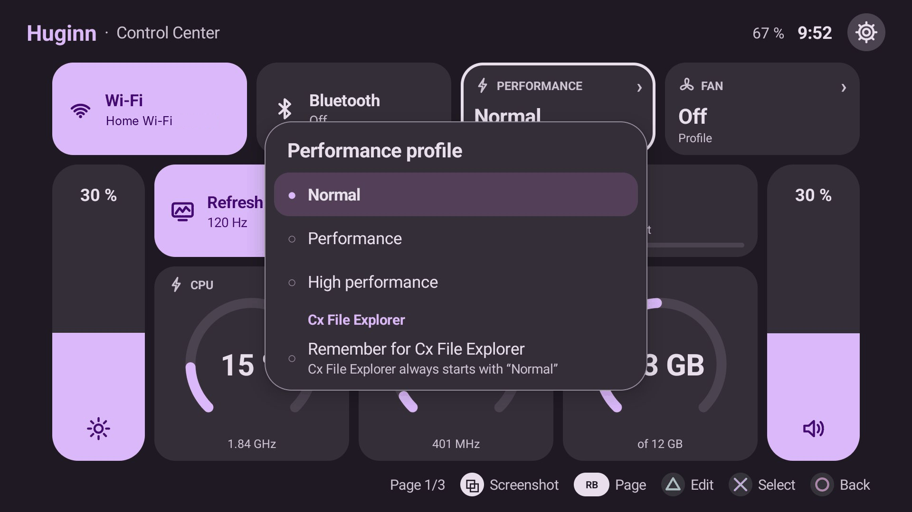
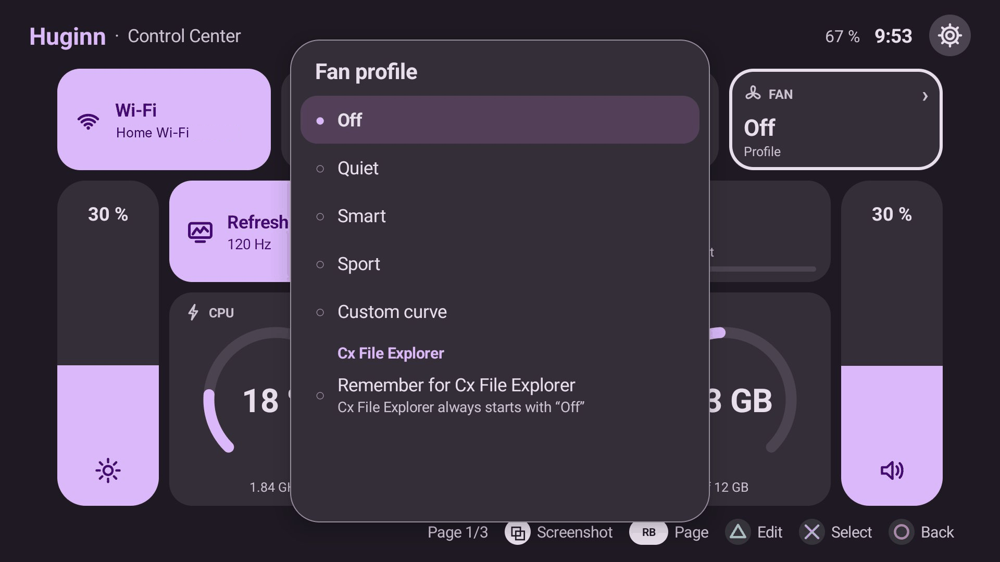
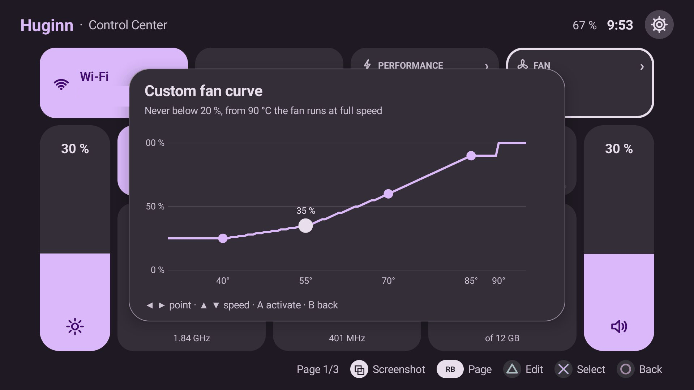

# Leistung und Lüfter

## Leistungsprofil

*Normal*, *Leistung* oder *Hohe Leistung*: die Profile der Firmware, die festlegen, wie schnell CPU und GPU laufen dürfen. Die Karte zeigt die aktuelle CPU-Grenze.

## Lüfterprofil

*Aus*, *Leise*, *Smart*, *Sport* oder *Eigene Kurve* – dieselben Modi wie in den Retroid-Einstellungen.

## Eigene Lüfterkurve

Fünf Punkte legen die Lüfterdrehzahl für jede Temperatur fest. Punkt wählen mit ◀ ▶, Drehzahl ändern mit ▲ ▼, übernehmen mit A, verlassen mit B. Hugminn hält immer eine Mindestdrehzahl und lässt den Lüfter ab 90 °C mit voller Kraft laufen, damit der Handheld nicht überhitzt.

## Profile pro Emulator und pro Spiel
Während ein Spiel oder Emulator läuft, bieten beide Menüs **„Für … merken“** an:
- **für den Emulator** (z. B. *Für Cemu merken*): der Emulator startet immer mit diesem Profil.
- **für das Spiel** (z. B. *Für The Wind Waker merken*), sobald Hugminn das laufende Spiel erkannt hat: nur dieses Spiel bekommt das Profil.

Ein Spielprofil geht vor dem des Emulators; was es offen lässt (wenn z. B. nur der Lüfter gesetzt ist), kommt aus dem Emulatorprofil. Weil das Spiel ein paar Sekunden nach dem Start erkannt wird, gilt zuerst das Emulatorprofil und dann das des Spiels. Auch ein Spielwechsel im Emulator wird bemerkt. Verlässt du ihn (Startbildschirm oder eine App ohne eigenes Profil), kommt die vorige Einstellung zurück.

Spielprofile gehen bei Emulatoren, deren Spieltitel Hugminn sehen kann. Bei Android-Spielen ist die App selbst das Spiel, dort reicht das Profil pro App.

Alle gespeicherten Profile stehen in den [Einstellungen](Einstellungen) unter *Profile pro App*, wo du sie auch löschen kannst.
