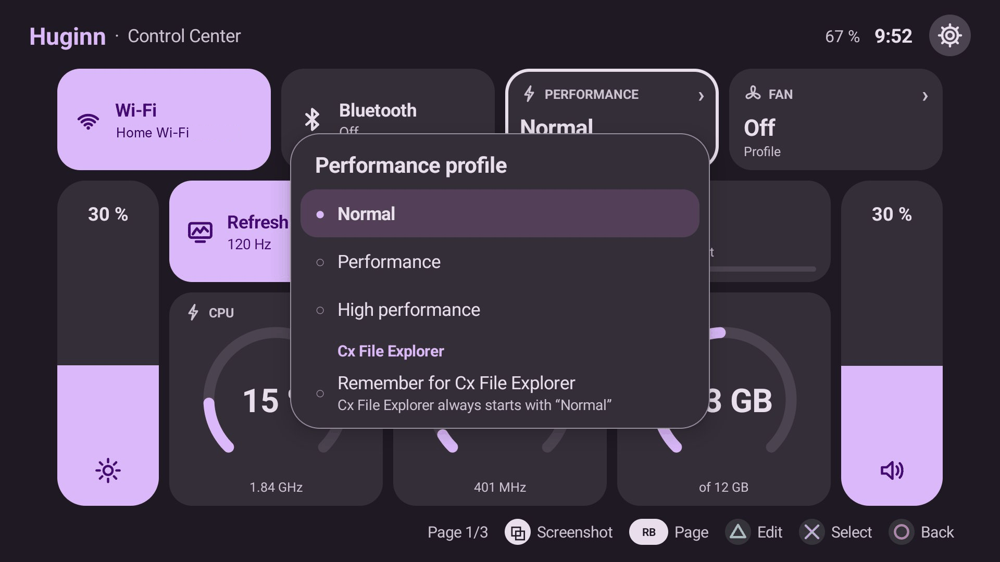
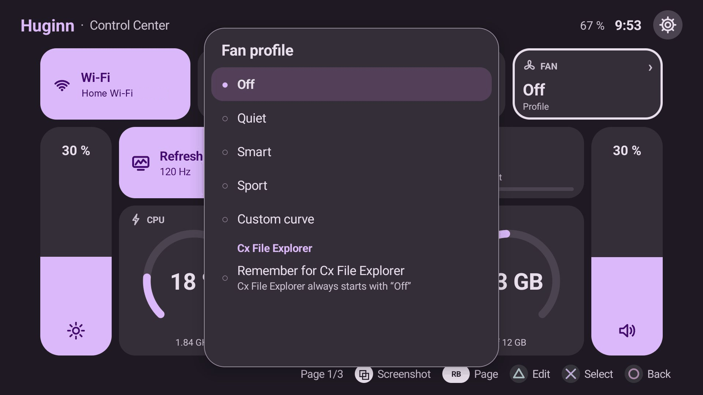
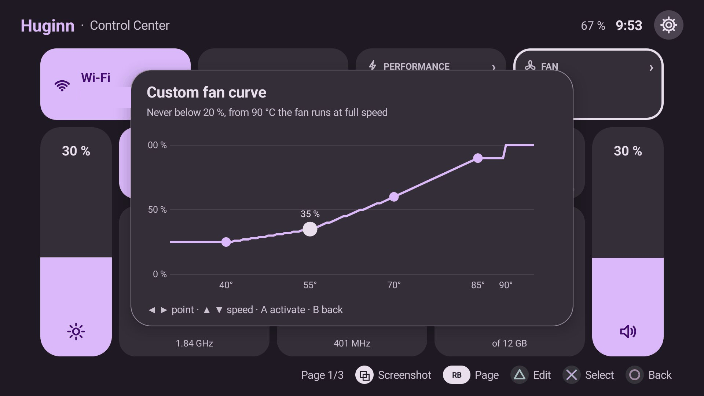

# Performance and fan

## Performance profile

*Normal*, *Performance* or *High performance*: the firmware's own profiles, which set how fast CPU and GPU may run. The card shows the current CPU limit.

## Fan profile

*Off*, *Quiet*, *Smart*, *Sport* or *Custom curve*, the same modes as in Retroid's settings.

## Custom fan curve

Five points set the fan speed for each temperature. Choose a point with ◀ ▶, change its speed with ▲ ▼, apply with A and leave with B. Hugminn always keeps a minimum speed and runs the fan at full speed from 90 °C, so the handheld cannot overheat.

## Profiles per emulator
While a game or emulator is running, both menus offer **"Remember for …"** (for example *Remember for Eden Nightly*). From then on that app always starts with this profile. When you leave it (home screen or an app without its own profile), the previous setting comes back.

All saved profiles are listed in the [settings](Settings) → *Profiles per app*, where you can remove them.
