# Setup wizard

The first time you open Hugminn, a short introduction walks you through everything. It is made for the controller: **Back**, **Skip** and **Next** stay in the same place on every page. You can open it again at any time: Settings → **Help & about** → *Show the introduction again*.

New in 1.12: Hugminn no longer grants itself anything silently. You decide about every permission, you open the Game Switcher and the Control Center once yourself, and a short button test checks that Hugminn sees all your buttons. At the end you can send a short summary – only if you want to.

## 1. Welcome
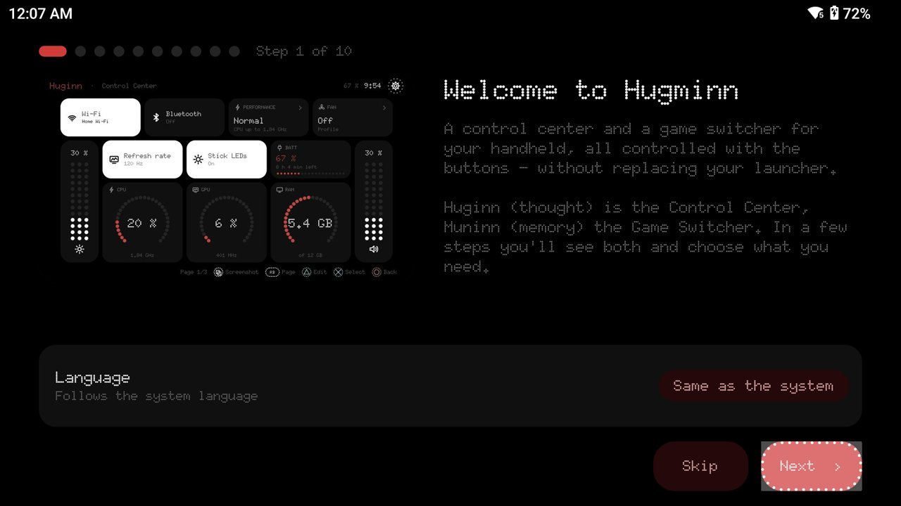

What Hugminn is. The language can be chosen here (follows the system by default).

## 2. Turn Hugminn on
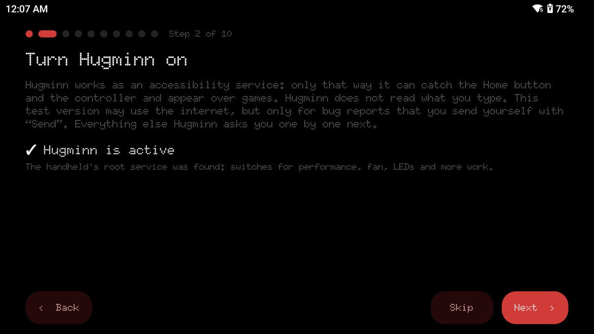

Hugminn works as an accessibility service – only that way it can catch the Home button and appear over games. This step switches on just that; everything else is asked one by one on the next page. The page also shows whether the handheld's root service was found (needed for performance, fan and LEDs).

## 3. What Hugminn may do
| Before | After |
| --- | --- |
| 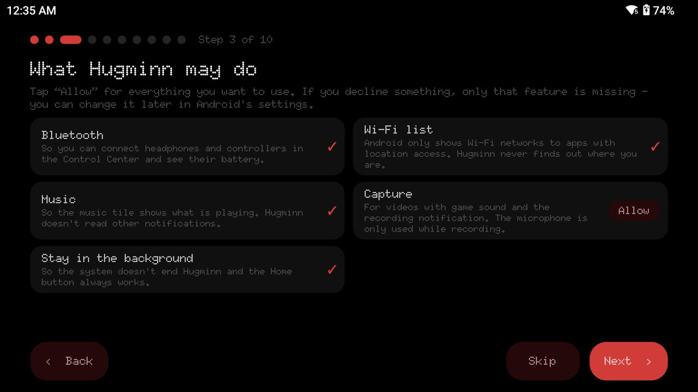 | 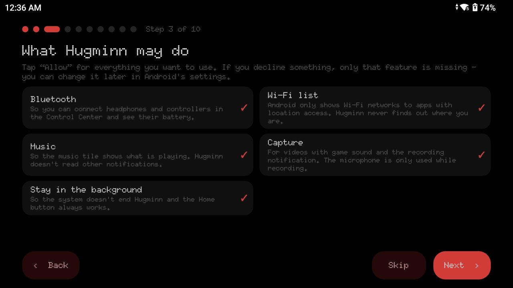 |

Every permission has a card with one sentence on what it is for. **Allow** opens Android's own dialog, or – for things Android has no dialog for – lets Hugminn switch it on through the root service. If you decline something, only that feature is missing.

| Card | Why |
| --- | --- |
| Bluetooth | Connect headphones and controllers in the Control Center and see their battery. |
| Wi-Fi list | Android only shows Wi-Fi networks to apps with location access. Hugminn never finds out where you are. |
| Music | So the music tile shows what is playing. Other notifications are not read. |
| Capture | Videos with game sound and the recording notification. The microphone is only used while recording. |
| Stay in the background | So the system doesn't end Hugminn and the Home button always works. Without root a short guide opens Android's "allow in the background" dialog. |
| Brightness & system values *(only without root)* | Brightness, screen timeout and similar sliders. |
| Recent apps *(only without root)* | How the switcher learns which games were open last. |

## 4. Try it out
| | |
| --- | --- |
| 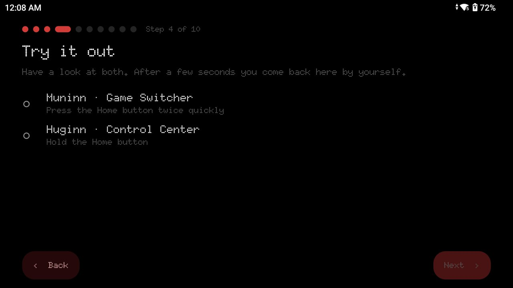 | 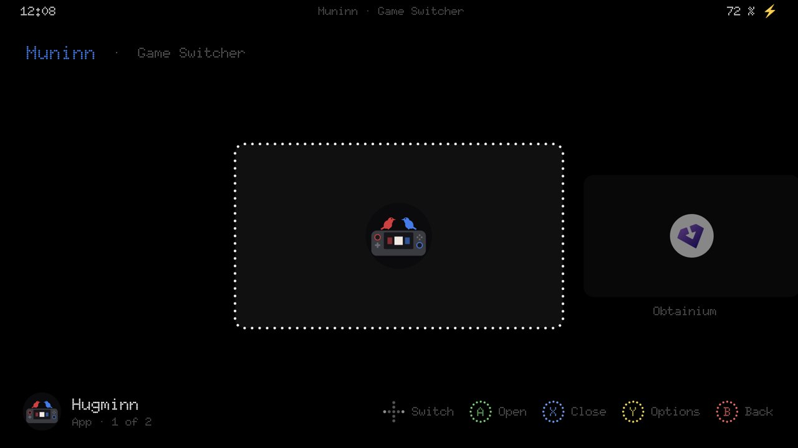 |
| 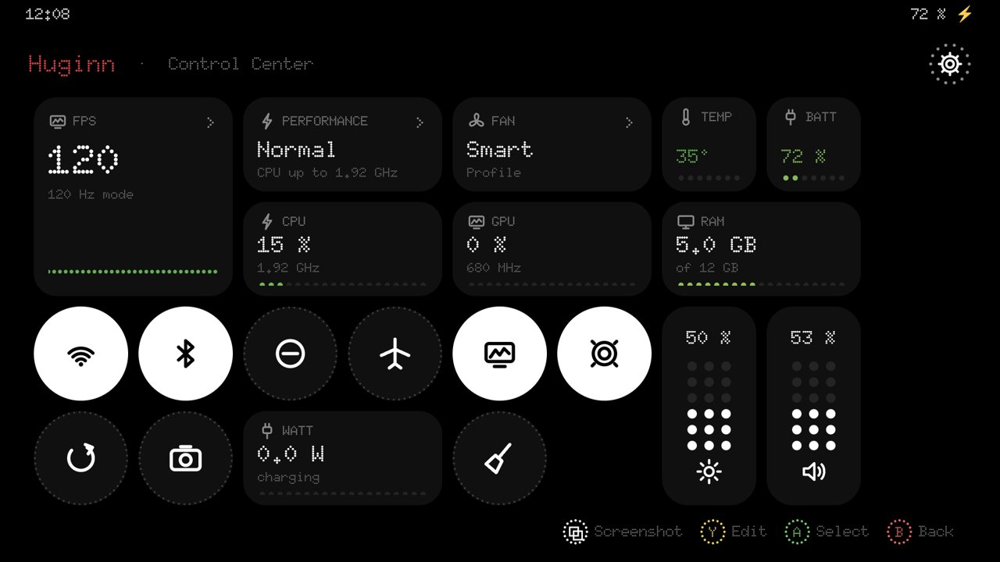 | |

Open the Game Switcher (Home twice) and the Control Center (hold Home) once yourself. Each closes after 5 seconds and you are back in the wizard. If a gesture doesn't work, *Doesn't work – continue* appears after 30 seconds (that is noted in the summary).

## 5. Button test
| | |
| --- | --- |
| 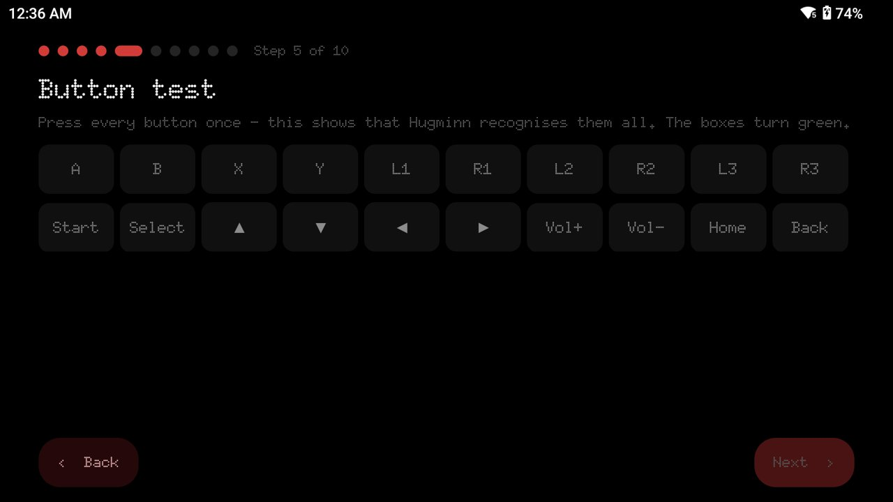 | 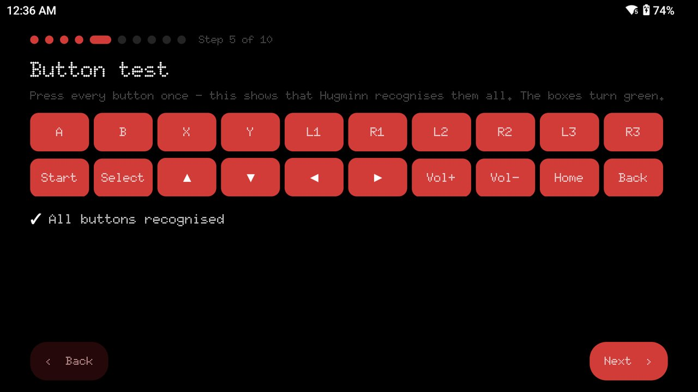 |

Press every button once: A, B, X, Y, shoulder buttons, triggers, stick clicks, Start, Select, D-pad, volume, Home and Back. The boxes turn green; when all are pressed, the wizard goes on by itself.

## 6. Game Switcher · 7. Control Center
| | |
| --- | --- |
| 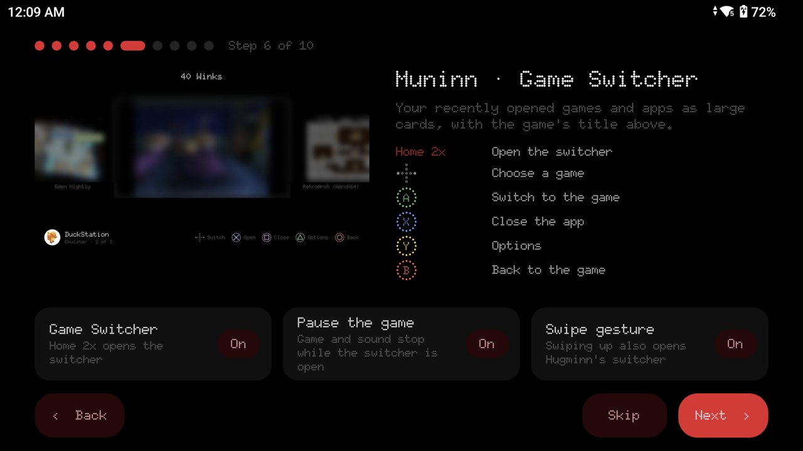 | 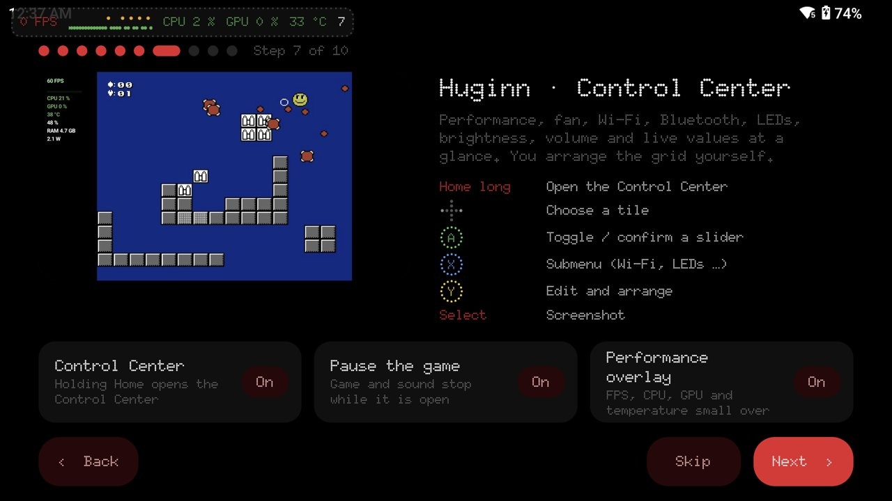 |

Switch each on or off, pause the game while it is open, the swipe gesture for the switcher and the [performance overlay](Performance-Overlay).

## 8. Look · 9. Button symbols
| | |
| --- | --- |
| 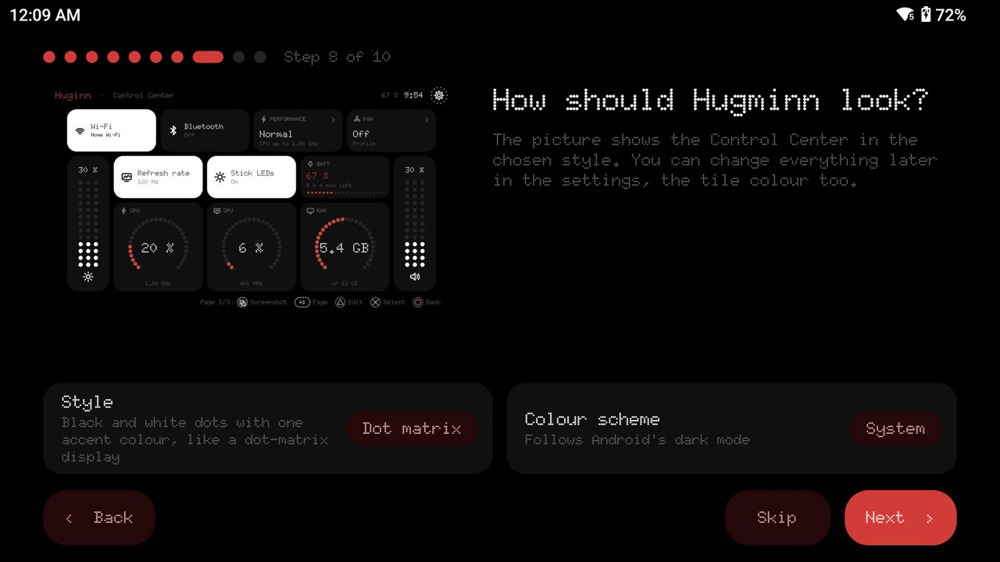 | 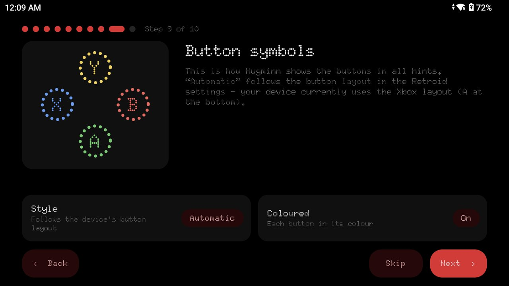 |

The [style](Styles-and-Themes) and colour scheme, then Modern, Retro or Modern (alternative) symbols (or *Automatic*, following the Retroid button layout), coloured or plain.

## 10. Done – and an optional report
| | |
| --- | --- |
| 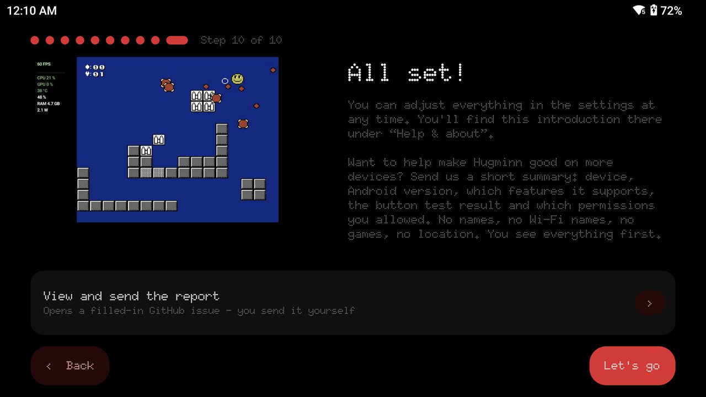 | 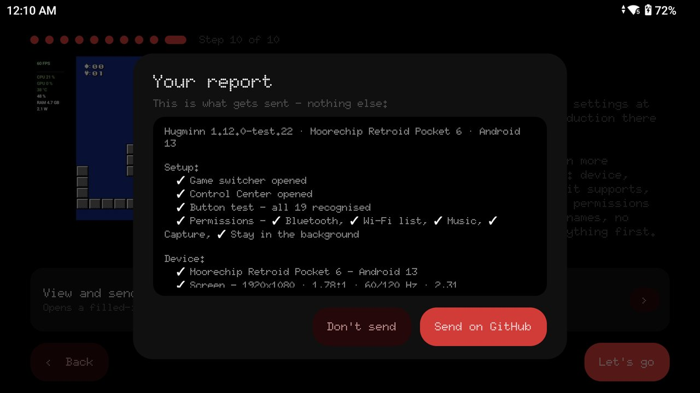 |

*View and send the report* shows exactly what would be sent: device, Android version, which features the device supports, whether switcher and Control Center opened, the button test and which permissions you allowed. **No names, no Wi-Fi names, no games, no location.** *Send on GitHub* opens a filled-in [device report](https://github.com/Ninte86hl/Hugminn/issues/new?template=device-report.yml) in your browser – you send it yourself. Hugminn itself has no internet permission.

Every choice can be changed later in the [settings](Settings).
