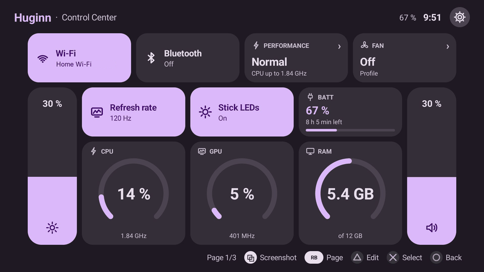

# Hugminn-Wiki (Deutsch)

*[English version](Home)*

Hugminn ergänzt Retroid-Handhelds um einen **Game Switcher** (Muninn) und ein **Control Center** (Huginn), beide komplett mit dem Controller bedienbar. Dein Launcher bleibt, wie er ist.

## Erste Schritte
- [Einrichtungsassistent](Einrichtungsassistent) – was die Einführung fragt und warum
- [Home-Taste](Home-Taste) – so öffnest du Switcher und Control Center

## Funktionen
- [Game Switcher](Game-Switcher-DE) – mit dem Steuerkreuz zwischen Spielen und Apps wechseln
- [Control Center](Control-Center-DE) – Kacheln, Regler, Live-Werte, WLAN- und Bluetooth-Menü
- [Control Center bearbeiten](Control-Center-bearbeiten) – Kacheln anordnen, Seiten, Kachelfarbe
- [Leistung und Lüfter](Leistung-und-Luefter) – Profile, eigene Lüfterkurve, Profile pro Emulator und Spiel
- [Stick-LEDs](Stick-LEDs-DE) – Farben, Effekte, Akku- und Temperaturanzeige
- [Leistungs-Overlay](Leistungs-Overlay) – FPS und Systemwerte über dem Spiel
- [Stile und Farbschemata](Stile-und-Farbschemata) – Modern, Pixel, Punktmatrix und Cocoon, hell und dunkel
- [Einstellungen](Einstellungen) – alle Optionen, Sichern und Wiederherstellen, Sprache

## Hintergrund
- [Berechtigungen](Berechtigungen) – wofür jede Berechtigung gebraucht wird
- [So funktioniert es](So-funktioniert-es) – technische Details
- [Fehler melden](Fehler-melden)
