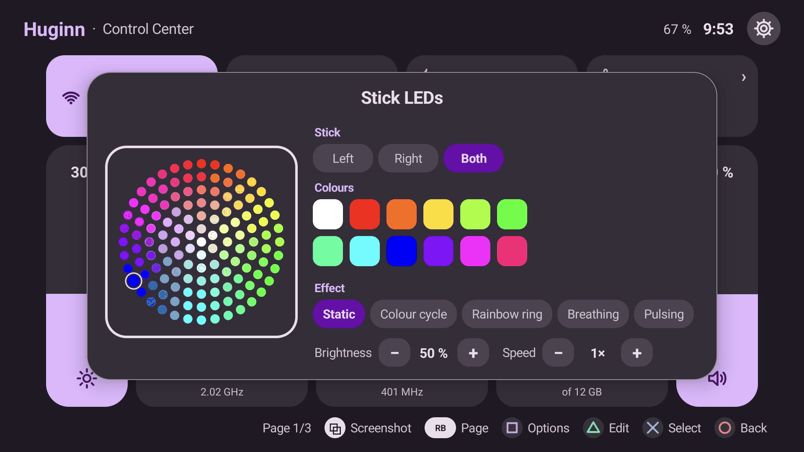

# Stick-LEDs

Die LED-Kachel (auf dem AYN Odin 2: *Beleuchtung*) öffnet ein Fenster mit drei Tabs – **L1 / R1** wechseln zwischen ihnen. Jedes Licht wird einzeln eingestellt: auf dem Retroid Pocket die beiden Sticks, auf dem AYN Odin 2 die beiden Sticks und die beiden Seitenleuchten.

## Gerät
- **◀ Licht ▶** – welches Licht du gerade einstellst.
- **Zeigt** – ein Schalter mit vier Stufen: **Aus · Farbe · Kombi · Effekt**. Jedes Licht merkt sich seine Farbe und seinen Effekt; der Schalter wählt nur, was davon leuchtet. Hin- und herschalten geht ohne neu einzustellen.
- **◀ Helligkeit / Sättigung ▶** und ein Balken – Leuchtstärke und Farbkraft dieses Lichts, in 5-%-Schritten.
- **◀ Kombi ▶** – Farbpaare (linke Lichter die erste Farbe, rechte die zweite). **A** schaltet alle eingeschalteten Lichter auf die Kombi.

## Modus
Effekte einzeln (◀ ▶): Statisch, Atmen, Pulsieren, Regenbogen, Farbwechsel – und als Anzeige *Akku* (grün, ab 50 % gelb, ab 20 % rot) und *Temperatur* (grün, ab 60 °C gelb, ab 75 °C rot). Atmen und Pulsieren nehmen die Farbe des Lichts. Ein Balken stellt das Tempo ein. *Für alle eingeschalteten Lichter* gibt allen denselben Effekt.

## Farbe
15 Farben, die 16. Kachel öffnet das Farbrad: mit dem Steuerkreuz steuern, die LED zeigt jede Farbe sofort, A übernimmt, B bricht ab. Nach der Wahl springt das Fenster zurück zu *Gerät*, bereit für das nächste Licht.

## Tasten
| Taste | |
| --- | --- |
| Steuerkreuz / Stick | zwischen den Feldern wechseln |
| A | Feld nehmen (dann ändert ◀ ▶ es), A nochmal bestätigt |
| Nord (Y · Retro X · △) | auf *Zeigt*: direkt zur Einstellung dessen, was das Licht zeigt (Farbe, Kombi oder Effekt) |
| West (X · Retro Y · □) | was dieses Licht zeigt (Farbe, Effekt, Helligkeit) auf alle Lichter übertragen |
| B | zurück zu *Gerät*; dort schließt es das Fenster |

Bei 10 % Akku pulsieren die Sticks rot.

## LED-Apps
Statt der eingebauten Farben kann die LED-Kachel eine LED-App wie [Bifrost](https://github.com/Pollux-MoonBench/Bifrost) oder AmbiLuma öffnen (Einstellungen → Control Center → *LED-App*). Hugminn überlässt die LEDs dann dieser App.

## LED-Tester
Der [Gerätetest](Geraetetest) schaltet jede LED-Einstellung und jede Treiber-Zone nacheinander ein und fragt, was leuchtet – praktisch, um herauszufinden, was ein neues Gerät kann.

## Grenzen
Jeder Stick leuchtet in nur einer Farbe; ein Regenbogen, der *um* einen Stick läuft, geht deshalb nicht. „Regenbogen“ gibt den beiden Seiten stattdessen versetzte Farben.
