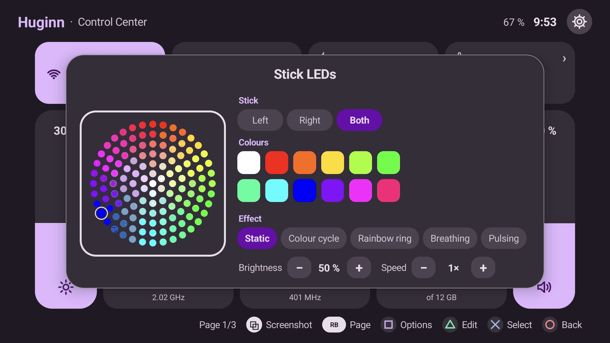

# Stick LEDs

- On/off, a colour wheel with live preview and 12 quick colours.
- **Shows:** the chosen *colour*, the *battery* or the *temperature*:
  - Battery: green, yellow from 50 %, red from 20 %
  - Temperature (hottest CPU core): green, yellow from 60 °C, red from 75 °C
- Left stick, right stick or both.
- Effects: static, colour cycle, rainbow ring (offset colours), breathing, pulsing; adjustable speed.
- Brightness uses the firmware's own value, the same as Retroid's LED window.
- The sticks pulse red when the battery drops to 10 %.

## LED apps
Instead of the built-in colours, the LED tile can open an LED app such as [Bifrost](https://github.com/Pollux-MoonBench/Bifrost) or AmbiLuma (Settings → Control Center → *LED app*).

## Limits
The Pocket 6 lights each stick in a single colour, so a rainbow running *around* one stick is not possible. "Rainbow ring" gives the two sticks offset colours instead.
